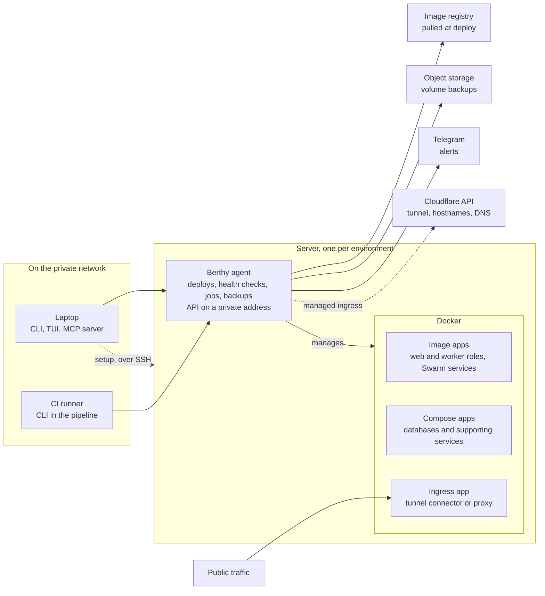

# Berthy v1 spec

Last updated: 2026-11-15

## Summary

Berthy is a small deployment and operations agent for Docker servers. It deploys image and Compose apps, shows live logs and metrics, and runs health checks with alerts. It can run commands in app containers on a schedule and back up Docker volumes to object storage. People use the CLI or terminal UI. AI agents use the CLI or MCP server.

It is built for a small team that runs a web application on its own servers: one server per environment, with an optional three-server cluster.

v1 is done when an environment can be run entirely through Berthy, with deploys, monitoring, alerts, scheduled jobs and backups all handled by it.

"Berthy" is a working name.

## Scope

v1 is deliberately small. It covers what it takes to run a web application and its supporting services on one server per environment, and nothing else.

**In scope**

- Deploy Docker image apps and Compose apps to one server per environment.
- Preparing a server with one command: `berthy setup` checks or installs Docker, turns on Swarm mode and installs the agent, over SSH or on the server itself.
- Optional managed ingress through Cloudflare Tunnel: Berthy creates the tunnel, runs its connector, and keeps public hostnames and DNS records in step with the manifest.
- Image deploys with no downtime: new version starts first, must pass its health check, and rolls back automatically if it does not.
- Live logs per app.
- Live metrics per server and per container: CPU, memory, disk space, Docker disk usage, block I/O and network I/O.
- Health checks with alerts to Telegram.
- Cron jobs that run commands inside image app or Compose service containers.
- Opt-in scheduled backups of app volumes to S3-compatible object storage, with a restore command.
- Every function available from the CLI with JSON output, and through MCP.
- A small footprint: one binary, no database server. The target is under 30 MB of resident memory for the agent, to be measured in phase 1.
- A deployment model that extends to a three-server cluster without redesign.
- Adopting apps that another deployment tool already runs, without recreating them.

**Out of scope for v1**

- A reverse proxy and certificates. Berthy ships no proxy; public traffic enters through a tunnel connector or proxy that runs as an app. Berthy can manage a Cloudflare Tunnel for this, and Cloudflare serves the certificates. Any other ingress is an ordinary app you configure yourself.
- Cloudflare settings beyond the tunnel, its hostnames and their DNS records, such as access policies and firewall rules.
- Building and pushing images. CI does both; Berthy deploys only images that already exist in a registry.
- Database provisioning and Postgres high availability.
- Users, teams and roles beyond token scopes.
- Templates and preview environments.
- A web UI.
- Long-term storage of logs and metrics. Berthy exports them over OpenTelemetry to a backend of your choice.
- Server provisioning and hardening beyond what `berthy setup` does. Creating the server, its users, its firewall and its private network stays with your provisioning.

## Architecture

Berthy is one static Go binary that runs in four modes, with an agent on each server and no central server between them.



The agent is the only component clients talk to. It drives Docker and reaches the registry, object storage and Telegram itself; public traffic enters only through the ingress app.

The one exception is `berthy setup`. It reaches a server over SSH to install the agent, because there is no agent to talk to yet. See Server setup.

| Mode | Runs on | Job |
| --- | --- | --- |
| Agent | Each server, as a systemd service | Talks to Docker, runs deploys, health checks, scheduled jobs and backups, and serves the API |
| CLI | Laptops and the CI runner | Sends commands to an agent; prints text or JSON |
| TUI | Laptops | Live view of apps, logs and metrics |
| MCP server | Wherever an AI agent runs | Exposes the same operations as tools |

### Decisions

- **One agent per server, no gateway.** Each environment's agent is self-sufficient. The CLI keeps one named context per environment and talks to the right agent directly.
- **Swarm mode is always on, even with one node.** Image apps run as Swarm services, which gives rolling updates and rollback for free, and the same model extends to a cluster.
- **Private network only.** The agent listens on one configured address, which should belong to a private network such as a WireGuard-based VPN. It never listens on all interfaces.
- **No bundled proxy.** Ingress is an app on the shared Docker network that routes to other apps by service name. With managed ingress, Berthy runs a Cloudflare Tunnel connector as that app and configures its routes; see Managed ingress with Cloudflare Tunnel.
- **A systemd service, not a container.** The agent keeps reporting when Docker itself is unhealthy. `berthy setup` installs it.
- **SSH for setup only.** Installing the agent is the single operation that uses SSH. Every other command goes through the agent's API, so Berthy stores no SSH credentials and day-to-day access needs no shell on the server.
- **HTTP and JSON API.** Streams (logs, metrics, deploy progress) use server-sent events, so `curl` and AI agents can read them without a client library.
- **Go.** Docker's client library, the Compose tooling and the strongest terminal UI libraries are all written in it.

### Where state lives

| State | Lives in |
| --- | --- |
| Desired configuration, including apps, checks, jobs and backups | Git, as a manifest in the application's repository |
| What is running | Docker; labels mark what Berthy manages |
| Secrets, deploy history, audit log, job status and backup records | One SQLite file on the server, secrets encrypted |
| Log and metric history | An OpenTelemetry backend, if one is configured |
| Volume backups | Object storage |
| Tunnel, public hostnames and DNS records, with managed ingress | Cloudflare; the manifest says what they should be |

The agent keeps a copy of the last applied manifest so schedules keep running between deploys. Git remains the source of truth.

## Application model

Berthy manages two kinds of application: image apps for stateless services and Compose apps for everything that holds data or supports the stack.

|  | Image app | Compose app |
| --- | --- | --- |
| Source | An image reference in a container registry | A Compose file from the repository at a given commit |
| Runs as | A Swarm service | A `docker compose` project on one named server |
| Used for | Web services and background workers | Databases, caches, telemetry backends, the ingress app |
| Update | Rolling: new starts first, gated on its health check, automatic rollback | Only changed services are recreated |
| Replicas | One or more | One per service |
| Ports | None published; reached by service name on the shared network | May bind a port to a private address |

### Rules

- **Roles.** An image app can define several roles that run the same image with different commands, such as `web` and `worker`. Each role has its own replica count, resources and health check, so web replicas can scale without multiplying job workers. An app can start with one role and split later.
- **Stateful apps are separate.** Deploying an image app never touches a Compose app. Restarting or recreating a Compose app marked `stateful` always takes an explicit command that names it.
- **Dependencies.** An app can name, in `depends_on`, the apps that must be deployed before it. The list orders `berthy deploy` without an app and nothing else: a deploy of one app does not deploy or check its dependencies. See Deploying every app.
- **Images are pinned by digest.** The agent resolves the tag to a digest at deploy time and records it. Rollback uses the recorded digest. Protected environments reject every tag, `latest` and a git SHA alike, and deploy only by digest. A release also records the tag the deploy asked for (`--version v1.0.2` records `v1.0.2`), which `history` shows as `tag`. The tag is a label only: the digest is what runs, and nothing decides from it. A digest deploy, a Compose app and an adoption record no tag, and a rollback records the tag of the release it returns to.
- **Compose project names are explicit.** A Compose app runs under the project name `<project>-<app>` unless `project_name` sets another. Compose names volumes after the project, so the name must not change once an app holds data.
- **Adoption.** Existing services and Compose projects can be adopted by name without being recreated. See Adopting an existing deployment.
- **Services deleted outside Berthy.** If a role's service is gone under both its bound name and its recorded ID, the next deploy or rollback recreates it under that name and binds the new service to the role. A service that carries the bound name under a different ID, or that still exists under its ID after a rename, is refused before any service changes.
- **One shared network.** All apps join one attachable overlay network, so the ingress app resolves them by name. Its name is set in the manifest, so an existing network can be kept. `berthy setup` creates it when it does not exist.

## Configuration

All desired configuration lives in the application's repository as one base manifest plus one overlay per environment.

- `berthy.yml` holds what is common.
- `berthy.<environment>.yml` overrides it per environment: replicas, resources, schedules.
- Every deploy carries the merged manifest from the commit being deployed. Nothing is configured by hand on the server.

The examples in this spec use two environments named `dev` and `prod`. Names and values are placeholders.

```yaml
# berthy.yml
project: myapp
network: myapp

registries:
  ghcr.io:
    username: <user>
    password_secret: REGISTRY_TOKEN

apps:
  api:
    kind: image
    image: ghcr.io/<org>/<image>
    depends_on: [postgres]
    roles:
      web:
        replicas: 1
        port: 8080
        health:
          test: ["CMD", "curl", "-f", "http://localhost:8080/health"]
          interval: 15s
          timeout: 5s
          start_period: 30s
          retries: 3
    env:
      plain:
        LOG_LEVEL: info
      secret:
        - DATABASE_URL
        - JWT_SIGNING_KEY
    deploy:
      deploy_timeout: 120s
      drain_timeout: 30s
      start_attempts: 3
      retain: 5
    hooks:
      pre_deploy:
        - backup: main-db

  postgres:
    kind: compose
    file: deploy/postgres/docker-compose.yml
    stateful: true
    env:
      plain:
        POSTGRES_DB: myapp
      secret:
        - POSTGRES_PASSWORD
```

### Environments

An environment is one named target: its own server or cluster, agent, overlay, secrets and tokens.

- **No default environment.** Every command names its environment with `-e <name>`. A command that changes something and names no environment is rejected.
- **Protected environments.** An overlay can set `protected: true`, typically for production. A protected environment rejects every image tag and deploys only by digest, and holds changes requested by AI agents until a person approves them.

```yaml
# berthy.prod.yml
protected: true
```

### Health checks

A role's health check is a command run inside the container, with the same fields Docker uses.

| Field | Meaning | Example |
| --- | --- | --- |
| `test` | Command run inside the container; exit code 0 means healthy | `curl -f http://localhost:8080/health` |
| `interval` | Time between checks | 15s |
| `timeout` | Longest one check may take | 5s |
| `start_period` | Grace period after start; failures in it do not count | 30s |
| `retries` | Consecutive failures before the container is unhealthy | 3 |

- Durations are written as `15s`, not in nanoseconds.
- The check runs inside the container, so the image must contain the command.
- With the example values a container that never becomes healthy is marked unhealthy after about 75 to 90 seconds, inside the 120-second `deploy_timeout`.
- A healthy container is first noticed about one `interval` after start, so every deploy takes at least that long. An optional `start_interval` checks more often during the start period; confirm the installed Docker version supports it for Swarm services before using it.

### Environment variables

- **Plain** values are written in the manifest and reviewed like code.
- **Secret** values are listed in the manifest by name only. The values live in the agent's encrypted store and are set with `berthy secret set NAME`, with `--registry HOST` for a registry password (see Registries).
- A deploy stops before changing anything if a named secret has no value.
- Values that differ between environments go in the overlays.
- Both kinds of app take the same `env` block. For a Compose app, Berthy writes the values into the project's environment file, where the Compose file reads them as `${NAME}`. Only the agent can read that file.
- Secrets are stored per environment. Other parts of the manifest refer to them by name as well: registries, backup destinations and telemetry.

### Registries

Image apps pull from any OCI registry. A private registry needs a credential, declared under `registries` with its password held as a secret.

```yaml
registries:
  ghcr.io:
    username: <user>
    password_secret: REGISTRY_TOKEN
```

- The credential should be read-only.
- The agent uses it to resolve tags to digests and to pull. It hands the credential to Swarm with the service, so every server in a cluster can pull.
- The password is set with `berthy secret set NAME --registry HOST`, where HOST is the registry's key under `registries`. The agent uses that secret only for that host. An environment secret is set without `--registry`, and an app's environment refuses a secret that has one.
- Compose apps use the same credential for images from a listed registry. A Compose deploy needs the credential of every registry the manifest lists, not only of those its images come from, because the agent writes them all for the Compose CLI; a missing one stops the deploy.
- A registry with no entry is pulled from anonymously.

### Checking a manifest

- `berthy config validate -e prod` checks the merged manifest without contacting a server.
- `berthy config show -e prod` prints the merged result with secret values hidden.

## Server setup

`berthy setup` takes a Linux server from a bare operating system to a running agent in one command, and deploys nothing.

```sh
berthy setup -e prod --host <user>@<server> --listen <private address>:<port>
```

It works in one of two ways.

| Where it runs | How | Used for |
| --- | --- | --- |
| From a laptop | `--host <user>@<server>` connects over SSH | Setting up a remote server by hand |
| On the server | `--local` runs the same steps directly | Provisioning tools and images that already carry the binary |

### What it does

1. **Connect.** Over SSH, or locally. The account must be root or able to use `sudo` without a password prompt: setup runs `sudo -n` and never asks for one. Over SSH, setup runs the `ssh` found on `PATH`, so keys, the agent, jump hosts and host key checks are the ones the operator already uses. Setup never takes a password and never stores a key.
2. **Check the server.** Linux with systemd, a supported CPU architecture, and the `--listen` address already assigned to the server. A server that already runs an agent for a different environment stops the run.
3. **Docker.** Confirm Docker Engine is installed, at a supported version, enabled at boot and running. If Docker is missing, install it with Docker's official install script. If it is stopped, start it.
4. **Swarm.** Turn on Swarm mode with the private address as the advertise address, and the Swarm management port listening on that address only, unless the server is already a manager.
5. **Network.** Create the shared attachable overlay network named in the manifest, unless it exists.
6. **Agent.** Create the `berthy` system user and add it to the `docker` group (`user`). Put the agent binary on the server (`binary`; see "Same version as the CLI" below). Create the state directory and the encryption key (`key`). Write the agent's configuration (`config`), then install the systemd unit, enable the service and start it, or restart it when the binary, the configuration or the unit changed (`service`). The new agent has to answer its health check; if it does not, setup puts the previous one back.
7. **First token and CLI configuration.** On a server that has no agent configuration, create one `admin` token and print it once (`token`). With `--config`, add the environment to the CLI's configuration with the agent's address (`cli_config`).
8. **Verify.** Call the new agent's `doctor` (`verify`). If this machine cannot reach the private address, setup says so and sends the same request on the server instead.

It ends by printing the next steps: store a copy of the encryption key off the server (the command that copies it, never the key), set the token in the environment variable the CLI configuration names, set the secrets, apply the managed ingress if the manifest declares one, and run the first deploy.

### Rules

- **It deploys nothing.** Setup never builds, pushes, pulls or starts an app. The first deploy is a separate `berthy deploy`, after the secrets are set.
- **Safe to run again.** Each step checks before it acts. A second run repairs what is missing and changes nothing else. It never replaces the encryption key, the tokens or the agent's state, and it never touches a running app.
- **It upgrades the agent.** Running setup with a newer CLI replaces the agent binary and restarts the service. Apps keep running while the agent restarts: setup never calls Docker for an app, and only the agent's process restarts. The new binary is first placed next to the live one (`/usr/local/bin/berthy.new`, checked against its SHA-256), then renamed over it with the previous one kept as `berthy.prev`; a changed configuration is handled the same way (`agent.json.new`, the previous one kept as `agent.json.prev`). Setup then waits up to 30 seconds for the agent to answer `GET /healthz` on its listen address, asked on the server. If it does not, setup puts the previous binary and configuration back, restarts the service, and fails the `service` step with `the new agent did not come up; the previous one was put back` and the last 20 lines of the agent's journal. On a first install there is nothing to put back: the step fails with the journal lines and leaves the service stopped. The `.prev` files are kept for one generation.
- **Existing Docker is left alone.** Setup does not upgrade or reconfigure a Docker installation it did not make. Docker older than the minimum supported version stops the run with a message. The minimum is Docker Engine 25.
- **Existing Swarm and network are kept.** A server that is already a manager keeps its Swarm. An existing network with the right name is used as it is; if it is not an attachable overlay, setup stops. A server that is a worker in another Swarm stops the run.
- **Same version as the CLI.** Setup installs the version of Berthy that runs it, chosen in this order:
  1. `--binary <path>`: a local file, which must be an ELF executable for the server's architecture (`x86_64` or `aarch64`) or setup stops.
  2. A Linux CLI of the server's architecture uploads itself.
  3. A release CLI on any other platform makes the server download the matching release, with `curl` or `wget`, from `<release URL>/<version>/berthy-linux-<arch>` (`amd64` or `arm64`) and `<release URL>/<version>/checksums.txt`, a file in `sha256sum` format with one line per artifact. The server checks the line of the artifact with `sha256sum -c` and stops with `checksum mismatch` if it differs. The release URL is `https://github.com/fredimachado/berthy/releases/download`, or the value of `BERTHY_RELEASE_URL`, which exists for tests and mirrors and must be `https`, or `http` on a loopback or private address. Releases are published by `.github/workflows/release.yml` when a `v*` tag is pushed: it builds static (`CGO_ENABLED=0`) binaries stamped with the tag for linux/amd64, linux/arm64, darwin/amd64, darwin/arm64 and windows/amd64, named `berthy-<os>-<arch>` (`.exe` on Windows), writes `checksums.txt` over them, and creates the GitHub release of the tag with them. A tag with a `-` is published as a prerelease, and a tag that does not match the release version pattern fails before anything is published. A release publishes only a commit whose CI run succeeded, and the workflow can also be run by hand as a dry run that checks and builds a commit and publishes nothing.
  4. A development build on any other platform has nothing to install: setup stops and asks for `--binary`.

  An upload streams the file through the SSH session into `berthy.new` and compares the SHA-256 the server computes with the local one. A server that already has that exact binary (by hash, or by version for a download) keeps it: the `binary` step is `ok`.
- **The encryption key is never replaced.** `--key-file` reads a saved key of exactly 32 bytes. If the server has a key, it must be the same one, or setup stops with `the server has a different encryption key; setup never replaces it`. If it has none, setup installs the saved key (mode 0600, owned by `berthy`; no key byte appears in a command line or in the output). Without `--key-file`, an existing key is kept; with no key and no state, setup generates one on the server, where it stays; with state but no key it stops with `/var/lib/berthy/state has state but no key: pass --key-file with the saved key`. Setup never reads a key back: it compares hashes.
- **The configuration is merged, never overwritten.** Setup starts from the server's own `agent.json` and sets only what it owns: `environment`, `listen` on the first run, `docker_socket`, `state_dir` and `key_file` when empty, `network`, and `protected` (set from the manifest or `--protected`, never turned off). Tokens and every other field are kept. A different `--listen` than the agent's is refused (`the agent listens on <address>; setup does not move it`), and `--listen` may be left out once the server has a configuration. A configuration that does not validate stops the run, without printing it. The file is written only when its content changes.
- **The first token is printed once.** A server without an agent configuration gets one `admin` token named `admin`. The agent's configuration holds its digest; the value exists only in setup's memory and appears once, after the step lines, as `admin token for <env> (shown once, store it now): bty.…`, and as `token` in `--json`. It is never in a step detail, an error or a log, on either side, and never in a command line or script sent to the server. `--new-token` adds another `admin` token named `admin-<UTC date and time>` and keeps the existing ones. If the service fails on a first install, the token is still shown, because the configuration that holds it stays in place. If a failed upgrade puts the previous configuration back, the new token is not shown.
- **The CLI configuration.** With `--config <path>`, setup adds or updates `environments.<env>` with `url` (`http://<listen address>`) and `token_env` (the variable the entry already names, or `BERTHY_<ENV>_TOKEN`, with `ENV` in upper case and other characters as `_`), keeps every other environment, and replaces the file atomically (a new file has mode 0600). The file never holds a token. Without `--config` the step is `skipped` and its detail says which entry to add.
- **Verify.** With an admin token (the one just made, or the one in the variable the CLI configuration names), setup calls `GET /v1/environments/<env>/doctor` from this machine with a 5 second connect timeout and prints a one-line summary; a critical check that is not ok fails the step and the run exits 1. If this machine cannot reach the agent, setup says so and sends the same request on the server with `curl`; the token goes to `curl` on its standard input, never in a command line. Without a token, setup only checks that `/healthz` answers.
- **Dry run.** `--dry-run` connects, runs every check and prints what would change, without changing anything on the server: not a package, a service, a setting or a temporary file. A step that would change something reports `would_change`.
- **Scriptable.** `--json` prints one object on standard output and nothing else. A failed step exits 1 and names the step; a wrong command line exits 2.

Each step has a name (`connect`, `check`, `docker`, `swarm`, `network`, `user`, `binary`, `key`, `token`, `config`, `service`, `cli_config`, `verify`) and ends with one status: `ok` (nothing to change), `changed`, `would_change` (a dry run), `skipped` or `failed`. A failed step stops the run.

```json
{"environment": "prod", "target": "ops@s1", "dry_run": false, "ok": true,
 "steps": [{"step": "docker", "status": "ok", "detail": "Docker 29.9.3, running, enabled"}],
 "token": "bty.prod.…", "next_steps": ["keep a copy of the encryption key off the server, …"]}
```

`token` is present only when this run made a token. `next_steps` is present after a successful run that is not a dry run. A dry run makes no token, writes no file and sends only reads to the server: the steps that would change something report `would_change`, and `verify` reports `skipped` with `would check the agent`.

### What it reads from the manifest

Run from the application's repository, setup reads two values from the merged manifest for the environment.

| Value | Used for | Without a manifest |
| --- | --- | --- |
| `network` | The shared network to create | `--network <name>` |
| `protected` | Marking the agent's environment as protected from its first start | `--protected` |

### Options

| Option | Meaning |
| --- | --- |
| `--host <user>@<server>` | Set up a remote server over SSH |
| `--local` | Set up the server the command runs on |
| `--listen <address>:<port>` | The private address the agent's API listens on. Required on the first run; later runs keep the agent's own. It must be one specific address of the server, not `0.0.0.0` or `::`, and a loopback, private or VPN address. |
| `--network <name>` | The shared network, when the directory has no manifest |
| `--protected` | Mark the environment as protected, when the directory has no manifest |
| `--manifest-dir <dir>` | Where to read the manifest from. The default is the current directory. |
| `--no-install-docker` | Stop if Docker is missing instead of installing it |
| `--dry-run`, `--json` | Report what would change without changing it; report as JSON |
| `--binary <path>` | Install this Linux build of Berthy instead of the CLI itself or the release that matches it |
| `--key-file <path>` | Install a saved encryption key instead of generating one, when rebuilding a server |
| `--new-token` | Add another `admin` token, for when the first one is lost |
| `--config <path>` | The CLI configuration to add the environment to. Without it, setup says what to add. |

### What it leaves on the server

| Item | Location |
| --- | --- |
| Binary | `/usr/local/bin/berthy`; the previous one as `berthy.prev` after an upgrade |
| Agent configuration | `/etc/berthy/agent.json`, owned by `berthy`, mode 0600 (the agent refuses a configuration that group or others can access); the previous one as `agent.json.prev` after a change |
| State | `/var/lib/berthy/state`, owned by `berthy`, mode 0700 |
| Encryption key | `/var/lib/berthy/key`, 32 bytes, owned by `berthy`, mode 0600 |
| Service | `/etc/systemd/system/berthy.service`, the file the repository ships as `deploy/systemd/berthy.service`, running as the `berthy` user in the `docker` group |

The agent's configuration names the environment, its listen address, the Docker socket, the state directory and key file, `protected`, the tokens, and `network`: the shared overlay network the apps join. Setup writes `network` from the manifest. `doctor` checks the network the configuration names, and when it names none, the network of the last applied manifest. With neither, the check is left out, as on a fresh agent before its first deploy. The agent's version is in its `agent` check and in `GET /v1/environments/<env>/agent`.

### What it does not do

- It does not create the server, its users, its firewall rules or its private network. The private address must exist before setup runs.
- It does not install or configure the VPN.
- It does not configure Docker's log rotation, storage driver or daemon options.
- It does not write a manifest. Start from the example in Configuration and check it with `berthy config validate`.

## Managed ingress with Cloudflare Tunnel

Berthy can own the whole path from a public hostname to an app: the tunnel, the connector that runs on the server, the hostname routes and the DNS records. It is optional, and it uses Cloudflare's API throughout.

Without it, publishing a new app means creating a tunnel in Cloudflare's dashboard, copying a command with a token to the server, then returning to the dashboard to point a hostname at the app's Docker service. With it, the hostname is one line in the manifest.

### Configuration

The base manifest turns managed ingress on. Hostnames usually differ by environment, so they go in the overlays.

```yaml
# berthy.yml
ingress:
  cloudflare:
    account_id: <account id>
    api_token_secret: CLOUDFLARE_API_TOKEN
    image: cloudflare/cloudflared:<version>
    replicas: 1
```

```yaml
# berthy.prod.yml
ingress:
  cloudflare:
    tunnel: myapp-prod

apps:
  api:
    roles:
      web:
        hostnames:
          - api.example.com
```

| Field | Meaning | Default |
| --- | --- | --- |
| `account_id` | The Cloudflare account that owns the tunnel | Required |
| `api_token_secret` | Name of the secret that holds the Cloudflare API token | Required |
| `image` | The connector image, pinned by digest at deploy like any image app | Required |
| `replicas` | Number of connectors | 1 |
| `tunnel` | The tunnel's name in Cloudflare | `<project>-<environment>` |
| `dns` | Whether Berthy creates DNS records | `true` |
| `hostnames`, on a role | Public hostnames that route to that role's `port` | None |

- **One tunnel per environment.** Every published app in the environment shares it.
- **A hostname belongs to one role.** The same hostname on two roles fails validation.
- **The target is worked out for you.** A hostname routes to `http://<project>-<app>-<role>:<port>`, the role's service name on the shared network. Swarm spreads requests across the role's healthy replicas.
- **The domain must already be in the Cloudflare account.** Berthy finds the zone from the hostname and does not add domains.

### What Berthy manages

| Item | How |
| --- | --- |
| Tunnel | Found by name, or created as a remotely managed tunnel |
| Connector | Run as a Swarm service on the shared network, with the tunnel's token as a secret. It appears in `ps` as `ingress`, and `logs` and `restart` work on it. |
| Routes | One rule per hostname in the tunnel's configuration |
| DNS | One proxied `CNAME` record per hostname, pointing at the tunnel |

The connector publishes no port. It makes outbound connections to Cloudflare only, on port 7844.

### When changes are applied

- **`berthy ingress apply -e prod`** creates or repairs the tunnel, deploys the connector, and brings every route and DNS record in line with the manifest. Run it once per environment, and again to change the connector's image or replicas.
- **`berthy deploy <app>`** updates that app's routes and DNS records as the last step of the deploy, once the new version is healthy. A new hostname goes live only after the app can answer it.
- **`berthy ingress status -e prod`** shows the tunnel's health as Cloudflare reports it, the connectors, and each hostname with its target and DNS record.
- **Removing a hostname** from the manifest removes its route and DNS record at the next apply or deploy of that app.
- **An app that is dropped from the manifest keeps its routes.** `ingress apply` removes the routes of an app only when the app has no applied release. An app that is still deployed but missing from the manifest keeps running, so its routes and records stay, and the plan and the dry run say so with `app <name> is deployed but not in the manifest; run berthy remove <name>`. `berthy doctor` lists such apps as `orphan_apps`. Run `berthy remove <name>` to take the app and its routes down.
- **Checks run first.** The check step of a deploy confirms the API token works, each hostname's zone is in the account, and no hostname is taken. A problem stops the deploy before anything changes.
- **Dry run.** `--dry-run` prints the routes and DNS records that would be added, changed or removed.

### Rules

- **Berthy only touches what it created.** A tunnel's routes are stored as one document, so Berthy reads it, changes its own rules and writes it back with every other rule kept. It marks the DNS records it creates and never edits or deletes one without that mark. A rule or record that already matched is adopted, not created: Berthy marks an adopted record so it can tell it from others, but remembers its old comment, and when the route goes away it releases what it adopted instead of deleting it. The adopted rule stays in the tunnel, and the adopted record stays in the zone with its old comment back. A rule or record that `--replace-existing` took over counts as Berthy's own, because Berthy replaced it with one it wrote.
- **An existing route or record stops the run.** If a hostname is already routed to a different target, or its DNS name is already used by a record Berthy did not create, the run stops and reports it. `--replace-existing` takes it over and needs an `admin` token. A route or record that already matches is adopted with no change.
- **Berthy's rules come first.** They are placed ahead of rules it did not write, and the tunnel's final catch-all rule stays last.
- **One writer.** Edit a managed hostname in the manifest, not in the dashboard. A dashboard edit to a managed route is overwritten at the next apply and shown in the dry run first.
- **The tunnel stays.** Removing managed ingress from the manifest removes the routes and records Berthy created and stops the connector, and leaves the tunnel. Berthy deletes a tunnel only with `berthy destroy --tunnel`, and only when it is clean (see "Destroying an environment").
- **Image apps only.** Hostnames can be declared on image app roles. A Compose service is published by a rule added in Cloudflare, which Berthy keeps.

### Credentials

- The API token needs two permissions: Cloudflare Tunnel edit on the account, and DNS edit on the zones that hold the hostnames. Limit it to those zones.
- It is stored in the agent's secret store like any other secret, and set with `berthy secret set CLOUDFLARE_API_TOKEN -e prod`.
- The agent calls Cloudflare itself, so the server needs outbound HTTPS to Cloudflare's API.
- The tunnel's token is fetched from the API, stored as a secret, and passed to the connector in its environment. It is never printed.
- **DNS edit is the larger risk.** A token with it can repoint any record in those zones. To avoid granting it, create one wildcard record that points at the tunnel by hand and set `dns: false`; Berthy then manages routes only.

### Health

- The connector's health check runs the connector's own readiness command, so its rolling update is gated like any other image app. Confirm the command against the pinned connector version.
- A second connector can run beside the first, so a connector update starts the new one before it stops the old one.
- `doctor` reports the tunnel's status as Cloudflare sees it. A tunnel that Cloudflare reports as degraded or down raises an alert.

### Adopting an existing tunnel

- Set `tunnel` to the existing tunnel's name. `ingress apply --dry-run` then shows what would change; existing routes and records that already match the manifest are adopted as they are.
- Only a remotely managed tunnel can be adopted: one created in the dashboard and run with a token. A tunnel configured by a file on the server has to be migrated in Cloudflare first.
- A connector started by hand keeps working next to Berthy's. Remove it once `ingress status` shows Berthy's connector as healthy, so traffic never drops.

### Limits

- Cloudflare's standard certificate covers one level of subdomain, such as `api.example.com`. A deeper name such as `api.dev.example.com` needs an advanced certificate, which Berthy does not order.
- Rotating the tunnel's token is done in Cloudflare's dashboard, followed by `ingress apply` to pick up the new one.
- Cloudflare is the only provider in v1.

## Deploy lifecycle

A deploy either finishes healthy or leaves the previous version running; it never leaves an app half-updated.

### Image app deploy

1. **Lock.** Take the environment's deploy lock. If someone holds it, stop and report who and why.
2. **Check.** Validate the manifest, confirm every named secret has a value, resolve the tag to a digest, pull the image.
3. **Pre-deploy hooks.** Run them in order. A failure stops the deploy with nothing changed.
4. **Start new.** Start the new version beside the old one. It must pass its health check within `deploy_timeout`; failures during the check's `start_period` do not count. A new version whose tasks fail to start `start_attempts` times (3 by default) is given up on at once, without waiting for `deploy_timeout`.
5. **Switch and drain.** Route traffic to the new version. The old one gets a stop signal and `drain_timeout` to finish requests in flight.
6. **Publish.** With managed ingress, update the app's routes and DNS records to match its `hostnames`. A failure is reported and the command exits non-zero, but the new version stays running.
7. **Post-deploy hooks.** Run them in order. A failure is reported but does not undo the deploy.
8. **Record and tidy.** Write the deploy record, prune old images, release the lock.

If step 4 fails, the agent rolls back to the previous digest, records the deploy as failed, and sends an alert.

### When a deploy fails

A new version can fail to start for reasons only its own output explains: a missing setting, a migration that did not apply, a health check that never passed. The old version keeps serving, and the evidence is kept before anything is cleaned up, so the cause can be found afterwards even though the failed task has been replaced and a service created by the deploy has been deleted.

- **What is kept.** Before a failed rollout is rolled back or removed, the agent reads, for every role in the deploy, the newest tasks of the new version (at most five per role), including failed, rejected and shut-down ones. Per task it keeps the Swarm state and error, the exit code, whether the container was killed for lack of memory, the health state and the last five health-check results, and the last 200 lines (at most 64 KiB) of its output with standard output and error interleaved. A failed pre-deploy or post-deploy command, a migration step, or one that ran past its time limit leaves the same for its container: exit code, error and the last lines of output. A piece that cannot be read is marked in that entry, and the rest is kept. Together the evidence of one deploy is limited to 1 MiB; the oldest logs are dropped first and marked truncated.
- **A public reason.** The operation also records one line saying what happened, such as `role web: task exited with code 1 (gave up after 3 failed starts)`, `role web: container never became healthy (last check: exit 1)`, `pre-deploy command 1 exited with code 3` or `migration apply exited with code 2 (after 3 attempts)`. It carries no output of the app, so it is safe in history and in the event stream. `berthy history` and the operation record show it; the deploy, rollback and ingress apply commands print it when they fail.
- **Redaction and storage.** Every managed secret value is replaced by `[redacted]` in the output and health-check results before they are stored. The evidence is encrypted in the state file like the other private records. The evidence of the newest 50 operations that have any is kept; older evidence is deleted. Containers of finished migration steps and of commands that timed out stay until `berthy prune` removes them, which is safe because the evidence already holds their output.
- **Reading it.** `berthy diagnostics <operation id> -e <env>` prints it for a person, and `--json` prints it for an agent; the id is in the output of the failed command and in `berthy history`. The API serves it at `GET /v1/environments/<env>/operations/<id>/diagnostics`. It needs the `deploy` scope, not `read`: application output can hold personal data that a read-only token should not see. An operation without evidence answers 404.

### Deploy lock

- One lock per environment, taken automatically for the length of a deploy.
- `berthy lock acquire -e prod -m "reason"` freezes deploys until someone releases it.
- The lock records its holder, message and age. `berthy lock status` shows them.

### Hooks

Hooks are declared per app as `pre_deploy` and `post_deploy` lists. Two step types exist in v1.

| Step | What it does | Typical use |
| --- | --- | --- |
| `backup: <name>` | Runs the named volume backup, including its preparation job if set, and waits for it. The name is a key of `backups` | Archiving a fresh database dump before a deploy |
| `run: <command>` | Runs the command in a container of the new image, with the app's environment. Runs once unless `retries` is set | A one-off task before traffic switches |

A `run` hook takes two optional settings.

| Setting | Meaning | Default |
| --- | --- | --- |
| `timeout` | Time limit of each attempt, from `1s` to `24h` | `5m` |
| `retries` | How many more times the command runs after it exits non-zero, from 0 to 5 | `0` |

```yaml
    hooks:
      pre_deploy:
        - run: [bin/warm-cache]
          timeout: 2m
          retries: 2
```

- **Retries are off by default, and a command should only be retried when it is safe to run again.** A command that failed halfway may have changed something. Set `retries` only for a command that is idempotent, such as one that checks a dependency or warms a cache.
- Each attempt runs in its own container, five seconds after the previous one ended. The deploy keeps the output of the last attempt, and the failure reason says how many attempts ran, such as `pre-deploy command 1 exited with code 3 (after 3 attempts)`.
- **A command that runs past its `timeout` is never retried.** It may still be running, so starting it again could run it twice. The deploy stops and the operation needs recovery, as it always did for a timed-out command.
- `backup:` steps take neither setting.
- **A backup step runs in order with the `run` steps** of its list, and runs the backup through the same code as `backup run`, with the trigger `hook`. The manifest being deployed supplies the backup, its destination and its volume, and the backup's `before` job runs first as for any run. A `backup` that no `backups` key names is refused when the manifest is read.
- **A failed `pre_deploy` backup stops the deploy before the migration block.** Nothing after it in the list runs, the migration's version and apply commands do not run, and the old version keeps serving. The operation fails with `pre-deploy backup failed`, and its reason names the backup and the step that failed, such as `pre-deploy backup main-db failed: upload failed`. `berthy diagnostics <operation>` (a `deploy` token) shows a diagnostic of kind `backup` with the run's own detail, such as `upload failed: access denied`, and no logs.
- **A failed `post_deploy` backup** is reported like a failed post-deploy command: the new version stays, and the operation fails with `post-deploy backup failed` and the same kind of reason.
- A backup whose app has no applied release has no volume to read yet, as on the first deploy of an app. The step is skipped, and the operation's events say so.
- A backup that cannot start, such as one of the same volume that is running, fails the step with its reason.

### Database migrations

Migrations run as their own deploy step, not at application startup, and the schema is never rolled back automatically when a deploy fails.

An app that applies migrations when it starts can leave the schema ahead of the running code after a failed deploy, with no defined way back.

**The rule that makes a failed deploy safe.** Every migration must work with the previous version of the app. A rolling deploy already runs the old and new versions against the same database for a short time, so this is required anyway. With it, a failed deploy needs no schema rollback: the old version keeps running on the new schema.

- Add columns and tables in one release; remove or rename them in a later one.
- A change that cannot be made compatible is split across two deploys.

**A generic contract.** Berthy does not know which migration tool an app uses. An app declares three commands, and Berthy runs each in a one-off container with the app's environment.

| Command | Contract | Runs from |
| --- | --- | --- |
| `version` | Prints one line that identifies the current schema state, such as the name of the last applied migration. Berthy stores it and never interprets it. | The new image |
| `apply` | Brings the schema to the latest state the image knows. | The new image |
| `revert` | Brings the schema back to a given state, passed as `{target}`. | The image being rolled back from |

```yaml
    migrations:
      version: [<command>]
      apply: [<command>]
      revert: [<command>, "{target}"]
      timeout: 5m
      retries: 0
```

`timeout` limits every migration command (`version`, `apply` and `revert`), each attempt on its own, from `1s` to `24h`; it defaults to `5m`. `retries`, from 0 to 5 and `0` by default, runs a failed `apply` again.

**Retrying `apply` is only safe for an idempotent command.** A migration that failed halfway may have applied part of its changes, and running it again from the middle can fail or change the schema twice. Berthy cannot know whether yours handles that, so `retries` is off. Turn it on for a migration tool that records each step in its own transaction and skips what it has applied, or for a failure that comes from outside the migration, such as a database that was still starting.

- `version` and `revert` are never retried.
- A migration command that runs past `timeout` is never retried, because it may still be running. The deploy stops with the outcome uncertain, and recovery stops the container.
- Each attempt of `apply` runs in its own container, five seconds after the previous one ended. The state after is recorded once, after the last attempt.

**How a deploy applies migrations.** The block runs after the pre-deploy hooks and before the new version starts.

1. The pre-deploy hooks have already run, including a `backup:` step if one is declared.
2. Berthy runs `version` and stores the result in the deploy record as the state before.
3. Berthy runs `apply`, once unless `retries` is set.
4. Berthy runs `version` again and stores the state after. One deploy can apply several migrations; the two recorded states mark exactly where it started and ended.
5. If `apply` fails, the deploy stops and the old version keeps running. The state after is still recorded, because a failed `apply` may have applied some of its migrations.
6. If it succeeds but the new version fails its health check, the image rolls back and the schema stays where it is.

**Reverting the schema on purpose.** `berthy rollback <app> --revert-schema` runs `revert` with `{target}` set to the state recorded before the failed deploy. Every migration that deploy applied is undone, and nothing else.

- It runs from the newer image, because that image holds the revert code for the migrations it added.
- With `--to <release id>` (the `id` column of `berthy history`), the target is the state recorded after that release's deploy.
- It takes an `admin` token and is never automatic, because reverting a migration can delete data.
- An app that declares no `revert` command cannot use it.

**Last resort.** Restore the pre-deploy backup to a new volume, then use the app's restore procedure. For a PostgreSQL dump, load it into a scratch database first. Recovery starts from the backup's capture time.

**What the app must provide.** The three commands must be runnable from the app's image. An app that migrates at startup stops doing so once Berthy runs the migration step.

### Timing settings

| Setting | Meaning | Docker's default | Berthy default |
| --- | --- | --- | --- |
| `deploy_timeout` | Longest the new version may take to become healthy | No overall limit; bounded by the health check | 120s |
| `drain_timeout` | Time the old version gets to finish requests | 10s | 30s |
| `start_attempts` | How many failed task starts a rollout tolerates before it gives up, from 1 to 10 | Unlimited restarts | 3 |

The wait before health checks count is the health check's own `start_period`, set per role.

**Start attempts.** Swarm restarts a task that exits or is killed as unhealthy. During a deploy Berthy counts those failures for each role of the new version and gives up as soon as one role's reach `start_attempts`: the old version keeps running, a service the deploy created is removed, and the deploy fails with a reason such as `role web: task exited with code 1 (gave up after 3 failed starts)`. A deploy that gives up this way does not wait out `deploy_timeout`. A new version that fails twice and starts on the third try passes with the default of 3. Failures of the old version, or from an earlier deploy, are not counted.

The limit applies to a rollout only. Once a version is serving, Swarm keeps restarting a task that crashes, without limit, so a service that dies at 3 in the morning comes back by itself.

Hook and migration time limits and retries are set with the hooks and migrations; see Hooks and Database migrations.

### Service defaults

An image app that sets nothing else runs with these Swarm settings.

| Setting | Berthy default |
| --- | --- |
| Update order | Start the new version first |
| Update parallelism | 1 at a time |
| On a failed update | Berthy counts failed starts of the new version (`start_attempts`, 3) and restores the previous version when they are used up; Swarm keeps replacing a failing task meanwhile |
| Rollback order and parallelism | Start first, 1 at a time |
| Restart policy | Restart on any exit, after 5 seconds, without limit; set explicitly on every service |
| Placement | No constraints |
| Replicas | 1 |
| Resource limits | None unless set per role |
| Stop grace period | `drain_timeout`, 30 seconds |

- Thirty seconds gives a web framework's graceful shutdown its full time to finish requests. Docker alone would stop the container after 10.
- With no memory limit, a leak in one app can starve a database on the same server. Set a limit per role once real usage is known.

### Rollback

`berthy rollback <app> -e <env>` redeploys the previous recorded digest with the manifest saved at that deploy. `--to <release id>` picks an older one: the `id` column of `berthy history`, not an operation id. Secrets stay at their current values.

### Retain and prune

- The agent keeps the images of the last `retain` deploys per app (default 5), so rollback needs no pull.
- After each successful deploy it removes older images, stopped containers and unused layers.
- It never removes volumes.
- An app that was removed with `berthy remove` has no applied release, so none of its releases protects an image any more; its images are removed at the next prune. Its release history stays.

### Compose app deploy

1. Take the lock and validate, as above.
2. Work out which services would be recreated and which volumes would be created, and print that plan.
3. If a `stateful` service would be recreated, stop unless the command carries `--allow-recreate`.
4. Write the Compose file and environment, then run `docker compose up -d --remove-orphans`.
5. Wait for health checks, record the deploy, release the lock.

The CLI reads the Compose file named by the app's `file` and sends its content with the request. The agent keeps that copy with the release, so a rollback redeploys the same file. Only that one file is sent, so a `build:` section is refused. These settings need an admin token: `privileged`, host `network_mode`, `pid`, `ipc`, `uts`, `userns_mode` or `cgroup`, `cap_add`, `devices`, relaxed `security_opt` entries, bind mounts of host paths, `env_file`, `secrets` or `configs` read from host files, and sharing a container outside the project (`volumes_from`, or `network_mode`, `pid`, `ipc` or `userns_mode` naming `container:`). The agent runs the Compose CLI named by `compose_command` (`docker compose` by default) with an isolated home directory, so the Compose plugin must be installed system-wide, or `compose_command` must name a standalone Compose binary. A bind mount must not point inside the agent's Compose directory, which each deploy replaces. A Compose deploy has no automatic rollback: a failed `up` is reported, and the next deploy brings the project to its file, since `up` is idempotent. Adoption records a release only when the plan would change nothing; otherwise it stops and names the first difference. `restart` restarts containers without recreating them, and `scale` and `exec` refuse Compose apps. `--version` does not apply to a Compose deploy.

### Removing an app

`berthy remove <app> -e <env> [--volumes] [--allow-recreate] [--dry-run]` takes an app down and removes what Berthy created for it. It takes an `admin` token, runs as an operation under the deploy lock, and needs no manifest: it works from the app's applied release. The ingress connector app cannot be removed this way; remove managed ingress with `ingress apply` and a manifest without an `ingress` block.

What it does, in this order:

1. **Routes and DNS records.** It removes the routes and DNS records Berthy created for the app. A route or record Berthy adopted is released, not deleted: its rows are dropped, an adopted DNS record gets its old comment back, and an adopted rule stays in the tunnel. A record that has lost Berthy's mark is left alone.
2. **Services.** An image app's services are deleted, one at a time, after each deletion is journaled. Each must still be the service the app is bound to (same name and ID), and any Berthy label it carries must name this environment, app and role; a service adopted with `--adopt` that has no labels yet is accepted. Otherwise nothing is deleted and the removal is refused. A service that is already gone counts as removed. A Compose app is brought down with `compose down --remove-orphans` in its stored project directory, which is then deleted. When the files are gone, Berthy runs `compose -p <project> down` with no file, which Compose resolves by label and which removes the project's containers and network.
3. **Volumes, only with `--volumes`.** An image app's volumes are the named volumes its roles mount (`name:/path`); a Compose app's are the project's named, non-external volumes, removed by `down --volumes`. A volume another container still uses is kept and reported. Berthy never removes an external volume or a volume the app does not name.
4. **State.** The app's bindings, applied release and route rows are forgotten. Releases, operations, job runs, backups and the audit log stay as history, so `history <app>` still works. The app is no longer monitored, scheduled or listed.

What it keeps: volumes unless `--volumes`, the release history, routes and records Berthy adopted, and the tunnel. A `stateful` Compose app is removed only with `--allow-recreate`, as it is recreated only with it. Removing an app again after it is gone changes nothing and succeeds. A removal that stops partway is finished by running it again; at start the agent also completes any service deletion it had journaled and records the operation as interrupted. `--dry-run` lists the services, volumes, routes and records, and the volumes that would be kept.

### Destroying an environment

`berthy destroy -e <env> --confirm <env> [--volumes] [--allow-recreate] [--tunnel] [--dry-run]` removes everything Berthy created in the environment. It takes an `admin` token and runs as one operation under the deploy lock. `--confirm` must repeat the environment name, or the CLI refuses before it sends anything and the agent refuses the request. `--dry-run` prints the whole plan and changes nothing.

What it does, in this order:

1. **Every app** with an applied release, except the connector, is removed as `berthy remove` removes it, with the same `--volumes` and `--allow-recreate` rules. If a `stateful` Compose app needs `--allow-recreate` and the flag is missing, or any other app cannot be removed, the whole destroy is refused up front, lists them, and removes nothing.
2. **Managed ingress** is removed: the routes and DNS records Berthy created, the release of the ones it adopted, the connector, the tunnel token and the stored ingress state.
3. **Helper containers and images.** The overlay probe helper container, every `berthy-helper` image no container uses, and any backup or restore helper container of this environment that has stopped.
4. **One-off containers.** Hook and migration containers of this environment that are not running.
5. **Images.** Every image Berthy pulled that no container or service uses, now that no app has a release.

What it keeps: all secrets, including the Cloudflare API token, the state database and the release, operation, job and backup history, the shared network, Docker objects Berthy did not create, routes and records that are not Berthy's, and volumes unless `--volumes`. A running container is left and reported. Running the command again after it stopped partway finishes it; at start the agent also completes a service deletion it had journaled, and records the operation as interrupted.

**`--tunnel`** deletes the Cloudflare tunnel, but only when nothing else uses it. Berthy remembers the tunnel when it removes managed ingress, so a later `destroy --tunnel` can still find it. The tunnel is deleted only if all of these hold after the connector is gone, and the result names each one that does not:

- its remotely managed configuration has no rule with a hostname, only catch-all rules (an adopted route stays in the tunnel, so it keeps the tunnel);
- no DNS record in any zone of the account points at `<tunnel id>.cfargotunnel.com`, which includes records Berthy adopted and released;
- Cloudflare reports no active connections, checked for up to a minute after the connector is removed, so a connector started by hand elsewhere keeps the tunnel.

A tunnel that is kept stays remembered, and `destroy --tunnel` deletes it once the reasons are gone. With no managed tunnel the command says "no managed tunnel".

### Deploying every app

`berthy deploy -e <env> --config <cfg>` without an app deploys every app of the manifest, one after another, each exactly as `berthy deploy <app>` would, and stops at the first app that does not succeed. It takes `--version`, `--commit`, `--dry-run`, `--json` and `--manifest-dir`; `--adopt`, `--replace-existing`, `--allow-recreate` and `--request-id` need an app and are refused with exit 2 (`--adopt needs an app: berthy deploy APP --adopt`). Each app is its own operation with its own request ID.

```yaml
apps:
  api:
    kind: image
    image: ghcr.io/<org>/<image>
    depends_on: [postgres, redis]
```

- **Order.** An app's `depends_on` lists the apps deployed before it. `config validate` refuses a name that is not an app of the manifest, an app that depends on itself, a name listed twice and a cycle (`depends_on cycle: api -> worker -> api`). Among the apps whose dependencies are done, the next one is the first by name, so the example above deploys `postgres`, `redis`, `api`. An overlay replaces the whole list, as it replaces any list. `depends_on` is a manifest key, and an agent refuses a key it does not know, so upgrade the agent with `berthy setup` before the first deploy of a manifest that uses it.
- **Versions.** `--version REF` is allowed only when the manifest has exactly one image app. Otherwise give `--version <app>=REF`, once for each app that needs one. A plain REF together with `<app>=REF`, an `<app>=` that names an unknown app or a Compose app, an empty REF and a repeated app are refused with exit 2 before any request is sent. A Compose app takes no version.
- **An app given no version keeps the one it runs.** The CLI sends such an image app with `keep_version`, and the agent deploys the digest of the app's applied release and records that release's tag. The new manifest is applied and the migrations and hooks run as in any deploy; only the image does not change. It is never resolved to `latest`. Before anything is deployed, the CLI asks the agent for the applied release of every app that keeps its version, with `GET /v1/environments/<env>/applied/<app>` (`read` scope; it answers `{"id", "digest", "tag"}`, `tag` only when the release has one, and 404 with code `not_deployed` when the app has no applied release). An app that was never deployed, or was removed, is refused with `image app <app> is not deployed yet: give --version <app>=REF` and exit 2, so a first deploy names a version for every image app. A protected environment accepts it: what the app keeps is a digest.
- **Everything is prepared first.** Nothing is sent to the agent until every app's request is ready: the manifest loaded, the Compose files read, the versions checked, the kept apps asked about. A bad Compose path or version for the last app leaves the first apps undeployed (`app zstack: compose file unavailable (nothing was deployed)`, exit 1).
- **Stops at the first failure.** Text output has one `==> deploy <app> (<version, or keeps <tag>>)` header for each app, followed by what `berthy deploy <app>` prints, and at the end one line each, `<app>  succeeded`. When an app fails, the command exits with its code, prints `deploy stopped at <app>; not run: <the apps after it>` on standard error, and runs nothing more. A change held for approval counts as a stop, with exit 3.
- **Dry run.** `--dry-run` plans every app and does not stop at a plan that fails; it exits 1 when any failed, and its summary lines say `planned` or `failed`.
- **JSON.** `--json` prints one document, with what `berthy deploy <app> --json` prints for each app as its `result`, in the order they ran; an app that did not run has `"state": "not_run"` and no result:

```json
{"apps": [
  {"app": "postgres", "exit": 0, "result": {}},
  {"app": "api", "exit": 1, "result": {}},
  {"app": "worker", "state": "not_run"}
]}
```

### Dry run

Every command that changes something accepts `--dry-run` and prints the plan without acting.

## Interfaces

The CLI is the complete interface; the TUI and the MCP server are two other ways to call the same agent API.

### CLI

Every command takes `-e <env>` and `--json`. Exit codes are meaningful: a failed or rolled-back deploy exits non-zero. A command that an AI agent's token ran on a protected environment, and that the agent held for approval instead of carrying out, exits with code 3: it is neither done nor failed (see "Approval for AI agents on protected environments").

Flags are checked before anything is sent. A read command refuses an unknown flag with exit 2 and `unknown flag`, before it reads any configuration. A change command refuses a flag it does not read with exit 2 and `<flag> is not a flag of <command>`, so `approve <id> --dry-run` is refused rather than approving for real.

Every command goes through the agent's API except `setup`, which runs over SSH or on the server and has no MCP tool.

| Command | Purpose | Changes things |
| --- | --- | --- |
| `ps` | Apps, roles, replicas, health, running version | No |
| `describe <app>` | Full detail for one app, including its last deploys and job results | No |
| `logs <app>` | Tail or follow logs; `--tail N`, `--follow` (or `-f`), `--since`, `--grep`, `--role`, `--replica` | No |
| `stats` | Server and container metrics; `--watch` for live, `--since DURATION` for the samples of that time (at most an hour) | No |
| `df` | Disk space and Docker disk usage | No |
| `history <app>` | Deploy records, with the reason of each failed deploy | No |
| `diagnostics <operation id>` | Evidence of a failed deploy: task and command state, exit codes, health checks and the last lines of output (needs the `deploy` scope) | No |
| `wait <app>` | Block until each service of the app, or of `--role`, has all its replicas running and healthy, or until `--timeout` passes (default 2m, at most 10m; then it exits non-zero). `--healthy` is accepted and changes nothing. A Compose app has no bound services, so it is refused | No |
| `doctor` | Checks the agent and its version, the host, root disk, Docker and its API version, Swarm manager, the shared network, the managed tunnel when configured, Compose, the deploy lock, each peer, the Telegram bot token secret when alerts need it, each backup, the overlay helper when a service probe needs it, apps that are deployed but no longer in the manifest, and telemetry when configured. It prints the CLI's version and the agent's, and a note when the agent runs a different release than the CLI | No |
| `version` | Prints the CLI's version and platform; `--json` for JSON. It needs no agent | No |
| `audit` | Who changed what and when | No |
| `config show`, `config validate` | Print or check the merged manifest | No |
| `backup list [--backup <name>]` | Backups in object storage: key, size, checksum and when each finished (`read` scope) | No |
| `ingress status` | Tunnel health, connectors, hostnames and DNS records, with managed ingress | No |
| `checks` | Stored state of every probe and built-in condition, with when each state began | No |
| `jobs` | Every job with its target, schedule, next occurrence and last run | No |
| `alerts test` | Send a test message through the Telegram channel | Yes |
| `job run <name>` | Run a job now, wait for it to finish and exit 0 only when it succeeded | Yes |
| `ingress apply` | Create or repair the tunnel and connector, and sync every route and DNS record | Yes |
| `setup` | Prepare a server and install or upgrade the agent, over SSH or locally | Yes |
| `deploy <app> --version <tag>` | Deploy an image app; a Compose app takes no `--version`. On a protected environment `--version` is a digest, never a tag | Yes |
| `deploy [--version <app>=<tag>]…` | Deploy every app in `depends_on` order and stop at the first failure; an image app given no version keeps the one it runs, and a plain `--version` is for a manifest with one image app (see Deploying every app) | Yes |
| `rollback <app>` | Return to a previous deploy | Yes |
| `restart <app>`, `scale <app>` | Restart or change replica count; `scale` is for image apps, and a Compose app is refused | Yes |
| `exec <app> -- <command>` | Run a command in a running container; image apps only, and a Compose app is refused | Yes |
| `secret set`, `secret list`, `secret rm` | Manage secret values; values are never printed | Yes |
| `lock acquire`, `lock release`, `lock status` | Manage the deploy lock | Yes |
| `recovery resolve OPERATION_ID -m REASON` | Finish an operation stuck in recovery as failed and release its lock (admin; `--dry-run` shows the journaled steps) | Yes |
| `backup run <name>` | Run a volume backup now, wait for it to finish and exit 0 only when it succeeded (`deploy` scope) | Yes |
| `restore <key> --into <volume>` | Restore a backup, named by its key from `backup list`, into a new Docker volume (`admin` scope; `--dry-run` checks the key and the name) | Yes |
| `state-backup` | Take a snapshot of the agent's state now, wait for it to finish and exit 0 only when it succeeded (`admin` scope) | Yes |
| `state-restore --endpoint URL --bucket NAME --object KEY --out DIR --key-file PATH` | Rebuild the agent's state from a state snapshot with the saved key, without an agent; the storage credentials come from `BERTHY_S3_ACCESS_KEY` and `BERTHY_S3_SECRET_KEY` | No |
| `prune` | Remove old images and stopped containers now | Yes |
| `destroy --confirm <env> [--volumes] [--allow-recreate] [--tunnel]` | Remove every app, managed ingress, helpers, one-off containers and acquired images of the environment; volumes only with `--volumes`, the tunnel only with `--tunnel` and when clean (admin) | Yes |
| `remove <app> [--volumes] [--allow-recreate]` | Delete an app's services or Compose project, its routes and DNS records, and its state; volumes only with `--volumes` (admin) | Yes |
| `approvals [--all]` | List the changes AI agents have asked for and that wait for a person: id, age, time left, who asked and what; `--all` also lists the decided and expired ones (`read` scope; the plan column needs `deploy`) | No |
| `approve <id>` | Show the plan of a change an AI agent asked for, carry it out as that agent and follow the operation it starts; it asks nothing more, so the person has read the plan in `approvals` first (`admin` scope, never an agent token) | Yes |
| `reject <id> [-m <reason>]` | Refuse a change an AI agent asked for; nothing runs (`admin` scope, never an agent token) | Yes |
| `agent token -e <env> [--agent] [--name <name>] [--scope read\|deploy\|admin]` | Make a token and print it once, with its digest and the object to paste into the agent's `tokens` list; it needs no agent and no network | No |

### TUI

`berthy ui -e <env> --config <cli config>` opens a full-screen live view built for reading first. It reads the same configuration and token as every other command, so a `read` token shows every view; the token is never drawn, logged or written. It needs a terminal on standard input and output and refuses to start without one. It is built with the Charm libraries (Bubble Tea, Bubbles, Lip Gloss, Huh for the confirmations and Glamour for the plans) and works at 80×24 and up; a smaller terminal gets a notice. Colours follow the terminal's light or dark background, and `NO_COLOR` turns them off: every state also has a glyph and a word, so nothing depends on colour.

The header shows the environment, a badge when it is protected, and the host. Four tabs hold the views:

- **Apps.** A table of the apps with kind, roles, replicas (running/desired), health (`●` healthy, `◐` starting, `✖` unhealthy, `○` none), version (image tag or short digest) and the age of the oldest newest backup, red when the last run failed. `/` filters by name. `enter` opens the detail of the app: its roles and replicas (state, health, restarts, out-of-memory kills), the last ten deploys with the reason of a failed one, its jobs and its backups. `l` follows its logs.
- **Logs.** A filterable picker of apps, then the followed logs of the chosen app: the last 200 lines and what comes, with the time, the source (role and the first 6 characters of the container id, such as `web.f77449`) and the stream (stderr is tinted). `f` pauses and resumes following, which also pauses when you scroll up. `p` shows the lines of one source at a time: all, then each source in the order first seen, then all again. `/` greps with a regular expression (smart case) on the lines the view keeps, the newest 5 000; a line must pass both the replica and the grep. `esc` clears both. What an app prints is shown with every escape and control sequence removed. A dropped stream reconnects with a growing wait and asks only for the lines it has not seen.
- **Server.** Meters for CPU, memory, swap and every mount, the load, the network and disk traffic, a sparkline of the CPU of the last minutes, the Docker disk usage, and the containers sorted by CPU with their memory, network and block I/O.
- **Approvals.** The changes AI agents have asked for, the ones that wait first, with who asked and the time left. `enter` shows the request and its plan, and a countdown while it waits; a token without the `deploy` scope sees that the plan is hidden.

The status line shows the connection (a spinner while a request is under way; `agent unreachable — retrying in 4s` when the agent cannot be reached, with the last data kept on the screen and the wait growing from 1 s to 30 s), the deploy lock, the oldest successful backup, the pending approvals and the age of the data. The footer shows the keys of the view; `?` shows them all.

| Key | Action |
| --- | --- |
| `tab`, `shift+tab`, `1`-`4` | Switch tabs |
| `↑` `↓` `j` `k`, `pgup` `pgdn`, `g` `G` | Move and scroll |
| `enter`, `esc` | Open, go back |
| `/` | Filter, grep |
| `f` | Follow logs on or off |
| `p` | In the logs, show one replica's lines, then the next, then all |
| `l` | Logs of the selected app |
| `R` | Restart the selected app (a role picker first when an image app has several roles) |
| `b` | Roll back the selected app (a picker of the earlier successful releases first) |
| `a`, `x` | Approve, reject the selected pending request on the Approvals tab |
| `r` | Refresh now |
| `?` | Help |
| `q`, `ctrl+c` | Quit |

The views read the agent API: the apps every 3 seconds, the lock and the number of pending approvals every 5, the approvals every 5 while their tab is open, the history of an app when its detail opens and every 10 seconds after, `df` every 30 seconds on the Server tab, and two event streams (`logs?follow=1` and `stats?watch=1`) that run only while their tab is open. The views only read: a change is made only through an action, below.

**Actions.** `R` restarts the app under the cursor or the open one, `b` rolls it back, and on the Approvals tab `a` approves and `x` rejects the selected pending request. The keys show in the footer only where they apply. Every action goes through one overlay and nothing is sent before the person confirms in it:

1. **Plan.** A restart or a roll back asks the agent for the same request with `dry_run` set, which is the plan `--dry-run` prints; an approval or a rejection reads the requests again and refuses at once when the request is no longer pending or has expired. A roll back first asks which release, in a list of the earlier successful releases from the app's history (id, tag when there is one, short digest, commit, age), the previous one chosen; a restart of an image app with several roles asks which role (the agent restarts one role at a time; a Compose app restarts as a whole).
2. **Confirm.** The plan is drawn as Markdown with Glamour in the colours of the interface, inside a scrolling pane: the facts (app, image and its whole digest, roles, what will happen) and the full plan as JSON. Every string of the agent goes into the document inside a code span, so nothing in it can be formatting. For an approval the overlay also shows who asked, how long ago, and a live countdown to the expiry. A Huh confirmation follows, with Cancel as the default. On a protected environment a roll back and an approval also ask for the environment's name, typed exactly (it is case sensitive), in the same form: the confirmation cannot be reached before the name is right. A rejection asks for an optional reason of up to 200 characters. `esc` cancels at any time before the confirmation and sends nothing; the overlay takes every key while it is open.
3. **Run.** The real request is sent with a fresh `request_id`; after a network error `r` sends it again with the same one, so the agent recognizes a retry. The agent can answer with an operation, which is followed; with a held request (the token is an AI agent's on a protected environment), which the overlay reports as "Held for approval <id>" with the command a person runs to approve it; with a result (a rejection); or with a refusal, which is shown with the agent's message and, for a `403` of a token that is too weak, the scope it needs (`deploy` to restart and roll back, `admin` to approve and reject).
4. **Follow.** The events of the operation stream in as a live list with a spinner and the time elapsed, on the same events stream and with the same checks as the CLI; a dropped stream reconnects without showing an event twice. It ends with the result: "Restarted api in 12s", or for a failed, rolled back or recovery-required operation the reason, the command `berthy diagnostics <operation> -e <env>`, and `d` to open the app. `esc` while it runs closes the overlay and leaves a note on the status line, "operation <id> continues on the agent": the operation is not cancelled.

When an action ends, the apps, the lock, the pending count, the approvals and the open app's history are read again at once. Only one action is open at a time; the views under the overlay go on updating.

### MCP server

`berthy mcp -e <env> --config <cli config> [--manifest-dir <dir>]` runs a local MCP server over stdio that calls the agent API with the token it was given. The token comes from the environment variable that the CLI configuration names for `<env>`, as for every other command; it is never printed and never part of a tool result. Only protocol messages go to stdout; diagnostics go to stderr. `--manifest-dir` (default `.`) is where `deploy` reads the manifest, and a Compose app's file, from, exactly as `berthy deploy` does. The server shares the CLI's HTTP client and request code, so an AI agent sees what a person sees, with the same errors.

Tool names follow those of the Aspire MCP server, so an AI agent can ask a deployed environment the same questions it asks a local run. Each tool returns the agent's JSON as structured content (a list is wrapped in an object, `{"resources": [...]}`) and a short text: a summary line followed by the same JSON, or for `list_console_logs` the log lines. Every tool is read-only except `execute_resource_command`, and the tools say so in their MCP annotations.

| Tool | Maps to | Inputs |
| --- | --- | --- |
| `list_resources` | `ps` | none |
| `describe_resource` | `describe` | `resource_name`, which may be `image:NAME`, `swarm:NAME` or `compose:NAME` |
| `list_console_logs` | `logs`, without `--follow` | `resource_name`; `role`, `since`, `grep`; `tail` (default 200, at most 1000) |
| `get_stats` | `stats` and `df` | none; the result has `stats` and `df` |
| `list_deploys` | `history` | `resource_name`; failed deploys carry their `operation_id` and reason |
| `get_deploy_diagnostics` | `diagnostics` | `operation_id` of a failed deploy (needs the `deploy` scope: a `read` token gets the agent's 403 as a tool error) |
| `list_backups` | `backup list` | `backup_name` (optional) |
| `wait_for_resources` | `wait` | `resource_name`; `role`; `timeout` (a duration, at most 10 minutes, default 2) |
| `doctor` | `doctor` | none |
| `list_approvals` | `approvals --all` | none: what became of the changes that were held |
| `execute_resource_command` | `deploy`, `rollback`, `restart`, `backup run`, `restore` | see below |

`execute_resource_command` takes `command`, one of `deploy`, `rollback`, `restart`, `backup_run` and `restore`, and the fields of that command; a field that does not belong to the command, or a missing one, is a tool error before anything reaches the agent.

| `command` | Fields | Scope the token needs |
| --- | --- | --- |
| `deploy` | `resource_name`, `version` (an image app; a Compose app takes none), `dry_run` | `deploy` |
| `rollback` | `resource_name`, `to` (a release id; default the previous one), `dry_run` | `deploy` |
| `restart` | `resource_name`, `role`, `dry_run` | `deploy` |
| `backup_run` | `backup_name` (no `dry_run`) | `deploy` |
| `restore` | `backup_key` (from `list_backups`), `into_volume`, `dry_run` | `admin` |

The result of `execute_resource_command` is one of:

- **Done or failed.** A started operation is followed until it ends, for at most 10 minutes: `{"operation_id", "state", "reason"}` (a backup run has `backup_run_id` and `key` instead). `state` is the agent's: `succeeded`, `failed`, `rolled_back`, `interrupted`, `recovery_required`, or `running` when the bound passed first. Any state but `succeeded` and `running` is marked as a tool error, and the text points to `get_deploy_diagnostics`.
- **Held.** On a protected environment an agent token's change is not carried out (see "Approval for AI agents on protected environments"). The result is `{"status": "held for approval", "approval_id", "expires", "plan"}`, it is not an error, and the text says `held for approval <id>: a person must run berthy approve <id>`. The AI agent has to tell the person and not retry; `list_approvals` shows later whether it was approved, rejected or expired.
- **Plan.** With `dry_run`, `{"dry_run": true, "plan": ...}`: the plan that `--dry-run` prints. It is never held.
- **Refused.** A 400, 403, 409 or other refusal of the agent (the wrong scope, a held deploy lock, an unknown app or a manifest that does not allow the image) is a tool error carrying the agent's message, never a protocol error.

A client such as Claude Code starts the server itself. With the token in the environment the client runs it in, the entry of a `.mcp.json` is:

```json
{
  "mcpServers": {
    "berthy": {
      "command": "berthy",
      "args": ["mcp", "-e", "prod", "--config", "/home/me/.config/berthy/config.json", "--manifest-dir", "/home/me/shop"],
      "env": { "BERTHY_PROD_TOKEN": "${BERTHY_PROD_TOKEN}" }
    }
  }
}
```

The configuration file is the CLI's: `{"environments": {"prod": {"url": "http://127.0.0.1:8443", "token_env": "BERTHY_PROD_TOKEN"}}}`. Any other stdio MCP client takes the same command, arguments and environment. Make the token with `berthy agent token -e prod --agent --scope deploy` (or `--scope read` to let the AI agent only look), so that on a protected environment its changes are held for a person.

## Monitoring, logs and health checks

The agent shows what is happening now and raises alerts. History is kept by an OpenTelemetry backend, if one is configured.

### Metrics

| Scope | Metrics | Read from |
| --- | --- | --- |
| Server | CPU, memory, swap, load, disk space per mount, disk I/O, network I/O | The kernel's `/proc` and filesystem stats |
| Docker | Disk used by images, containers, volumes and build cache | The Docker API |
| Container | CPU, memory against its limit, block I/O, network I/O, restarts, out-of-memory kills | Control groups and the Docker API |

- Sampled every 10 seconds (proposed).
- The last hour is held in memory for `stats` and the TUI. Nothing is written to disk.
- Samples are exported over OpenTelemetry when the manifest names an endpoint. Without one, Berthy still shows live metrics and the last hour.

```yaml
telemetry:
  otlp_endpoint: http://<collector>:4318
  headers_secret: OTLP_HEADERS   # optional
```

- `headers_secret` names a secret that holds request headers in the standard `OTEL_EXPORTER_OTLP_HEADERS` form, `name=value,name=value`. Backends that require authorization need it.
- The agent runs on the host, so the endpoint must be an address the host can reach, such as a port published on a private address. A Docker service name does not resolve there.

### Logs

- `logs` tails or follows container output straight from Docker, per app, role or replica.
- A text line is the time in UTC, the source and the message. The source is the role and the first 12 characters of the container id (`web.f77449eeec32`), the ones `docker ps` shows; a stderr line is marked `[stderr]`. `--json` prints the records instead.
- `--replica` names a replica by its task id, its container id, or a prefix of at least 6 characters. A shorter prefix matches only a whole id. A prefix that matches more than one replica of the app, on any node, is refused with `bad_request`.
- The agent stores no logs. History and search belong to a log backend the apps send to.
- Log rotation is left to the server's Docker configuration.

### Health checks

| Kind | What it checks | Effect |
| --- | --- | --- |
| Container health check | The check declared for a role in the manifest | Gates deploys; an unhealthy container is replaced |
| Probe | An HTTP or TCP check the agent runs on a schedule, against a service name or a public URL | Alert |
| Built-in condition | Disk space, Docker disk usage, memory, restart loops, overdue backup, silent peer, unhealthy tunnel with managed ingress | Alert |

Proposed thresholds: disk space and Docker disk usage warn at 80% and go critical at 90%.

**Where a probe runs.** The agent runs on the host, where Docker service names do not resolve and addresses on the shared overlay network cannot be reached.

- A probe against a public URL, or an address the host can reach, is run by the agent itself.
- A probe against a service name runs in the overlay helper: one container per environment on each server, built by the agent from its own static binary as `berthy-helper:<hash>` (no registry and no internet), attached to the shared network and published on 127.0.0.1 only. The agent gives it probes over a bearer token that it keeps in memory, so a restart recreates the helper with a new token, and a Compose service must join the shared network to be probed.

#### Configuration

Probes, peers and alerts are part of the manifest, so they are reviewed like code. Monitoring uses the last applied manifest: the one stored with the most recent release of any app, except the managed ingress connector. A release the agent cannot read keeps the checks that are already running.

```yaml
probes:
  site:
    http: https://app.example.com/health    # or tcp: 10.0.0.5:5432, or service: {app: api, port: 8080, path: /health}
    expect_status: [200, 204]               # default: any status from 200 to 399
    interval: 30s                           # default 30s, at least 5s
    timeout: 5s                             # default 5s, and shorter than the interval
    failures: 3                             # failed runs in a row before the state changes; default 3
peers:
  prod: https://prod.example.com:8443       # the other agent's base URL, with no path
alerts:
  telegram:
    bot_token_secret: TELEGRAM_BOT_TOKEN    # the name of a secret that holds the bot token
    chat_id: "-1001234567890"               # quote it; or "@channel_name"
    reminder: 4h                            # while a check keeps failing; 0s turns reminders off
```

- A check changes state after it has failed the configured number of times in a row. One success recovers it at once. Unknown results never alert.
- A service probe runs in the overlay helper. When the helper is not running, or the service cannot be named, the probe is unknown and its detail gives the reason. Its timeout is from 1s to 25s.
- Each peer is asked for `/healthz` every 30 seconds with a 5-second timeout, and is critical after three misses. `/healthz` needs no token and answers `{"ok":true}` and nothing else.
- Built-in conditions always run: disk and Docker disk (warning from 80%, critical from 90%), memory (warning below 10% available, critical below 5%), restart loops of the apps Berthy manages (three restarts of one replica, or three Swarm tasks that failed or were rejected, within 10 minutes, or an out-of-memory kill; shutdowns, such as a rolling update's old tasks, do not count; unmanaged Swarm services and Compose projects are not checked), and the tunnel when managed ingress is set up.
- Disk checks cover `/`, the mount that holds Docker's data, and every mount of at least 1 GiB; smaller mounts are skipped.
- An alert is sent when a state changes: 🔴 for critical, 🟠 for warning, ✅ on recovery. Reminders read 🔁 still failing. `berthy alerts test -e ENV` sends a test message to check the channel.

### Alerts

- Alerts go to Telegram only in v1. Other channels can be added later.
- An alert is sent when a check changes state, failing or recovering, with a reminder while it stays failing.

### Peer check

Agents in different environments can be named as peers. Each probes the others over the private network and alerts when one goes silent. This covers a server that is completely down, which cannot report itself.

It does not cover all servers failing together or an outage of the private network. Keep one external check on the application's public URL for that.

## Scheduled container commands

Declare a named command under `jobs` in the manifest. Each job can have its own five-field cron schedule in UTC.

```yaml
jobs:
  cleanup:
    app: api
    role: web
    schedule: "30 2 * * *"
    command: ["/app/bin/cleanup"]
```

- Select the app with `app`. For a Compose app, use `service` to select the service. For an image app, use `role` to select the role. The selector can be omitted when the app has exactly one service or role.
- Jobs come from the last applied manifest, which the agent re-reads every minute, so a changed schedule takes effect at the next minute after its deploy.
- At each scheduled time, Berthy runs `command` once in a running container for the target, even when the role has several replicas. For an image app it picks the running replica with the lowest slot on the agent's node. For a Compose app it picks the lowest-numbered running container of the service; if the app has several services running and no `service` is named, the run fails and says so. The command uses the container's environment and mounts. Include a shell explicitly if the command needs shell syntax.
- `timeout` (default `1h`, from `1s` to `24h`) limits a run. A run that exceeds it fails with `timed out after <timeout>`. The wait ends, but the command may still be running inside the container, because Docker has no way to stop one exec.
- Each scheduled occurrence runs at most once. The agent records the occurrence in its state before it runs, so restarting the agent in the same minute cannot run it twice. Occurrences that pass while the agent is down are not made up.
- Berthy records each run's start, end, trigger, container, exit status and a short reason, and `describe <app>` and `berthy jobs` show the last run. A nonzero exit, a missing running container, an exec error or a timeout fails the run and raises an alert through the `job:<name>` check, which stays critical until a later run succeeds. If the job is still running at its next scheduled time, Berthy skips that occurrence and records the skip; a skip never raises an alert.
- The command's output is read and thrown away, so a job may print as much as it likes. It is not stored, because it may contain secrets. The record holds the exit code and a fixed reason such as `exit status 3`, `no running container for api/web` or `exec failed`.
- When the agent is stopped in an orderly way (a restart or an upgrade) while a job runs, the run is recorded as `interrupted` with `agent stopped during the run`. Like a skip, an interrupted run never raises an alert and does not change the job's check. A run still marked running when the agent starts again, because the agent crashed or was killed, is recorded as failed with `agent restarted during the run`. In both cases the command may still be running in its container.
- Every run is written to the audit log with the job as the caller (`job:<name>`, action `job_run:<name>`, outcome `succeeded`, `failed`, `skipped` or `interrupted`). Jobs do not take the deploy lock, so they can run during a deploy.
- A job with no `schedule` runs only on demand, as preparation for a volume backup or with `berthy job run <name> -e ENV`. The command starts the run, waits until it finishes or its `timeout` plus 30 seconds passes, prints the status, exit code and reason, and exits 0 only when the run succeeded. It fails at once when a run of the job is already in progress. It takes a `deploy` token, and the audit log records which token asked (`job_start:<name>`).
- `berthy jobs -e ENV` lists every job with its target, schedule, next occurrence and last run, and takes a `read` token.

## Volume backups and restore

Any named Docker volume mounted by a managed app can have a backup. Declare a job for each volume to back up, with the source volume, an S3-compatible destination and, for automatic backups, a five-field UTC cron schedule.

### Configuration

This example backs up the `uploads` volume mounted by a service in a Compose app named `files`.

```yaml
destinations:
  offsite:
    type: s3
    endpoint: https://<s3-endpoint>
    bucket: <bucket>
    access_key_secret: S3_ACCESS_KEY
    secret_key_secret: S3_SECRET_KEY

backups:
  uploads:
    app: files
    volume: uploads
    schedule: "0 0 * * *"
    destination: offsite
    prefix: files/uploads
    retention:
      keep: all            # or a number of most recent backups
```

- For a Compose app, `volume` is the key in the Compose file's top-level `volumes` block. Berthy resolves it using the app's Compose project name and any explicit volume name.
- For an image app, `volume` is the Docker volume name mounted by one of its roles. A role declares mounts under `volumes`, with entries such as `uploads:/app/uploads`.
- Omit `schedule` to run a backup only through `backup run` or a deploy hook.
- **Schedules.** A backup with a `schedule` runs once per UTC cron occurrence, with the trigger `schedule`. The agent reads the manifest of the deployed apps every minute, so a changed schedule takes effect at the next minute after its deploy. Each occurrence is recorded in the agent's state before it runs and at most once, so restarting the agent in the same minute, or a second process on the same state, cannot run it twice. Occurrences that pass while the agent is down are not made up. If a backup of the same Docker volume is still running at an occurrence, the occurrence is skipped: nothing is recorded, the agent logs `skipped: previous backup still running`, and nothing alerts. A scheduled run that cannot start, such as one whose credentials are gone, is recorded as a failed run so that the backup's check shows why. Every scheduled run is written to the audit log with the backup as the caller (`backup:<name>`, action `backup_run:<name>`, outcomes `started`, then `succeeded` or `failed`).
- `retention.keep` defaults to `all`. Set it to a number to retain that many successful backups for the job.

### How a backup runs

1. If the backup names a job under `before`, the agent runs that command and waits for it to succeed. This applies to scheduled backups, manual runs and deploy hooks. A preparation that fails fails the backup with `preparation failed: <reason of the job run>`, and no archive is started.
2. The agent reads the volume through a read-only mount and streams a compressed archive to object storage, hashing it on the way. A failed archive or upload is aborted and never listed as a successful backup.
3. Only after the archive is stored does the agent write its sidecar, then it records the source volume, object key, size, duration and checksum, and applies retention.

Backups of the same volume run one at a time: a second one is refused with `409` while one runs, and records nothing. If the preparation job has its own schedule, the backup waits for any active run to finish, then reserves the job until archiving finishes; a scheduled occurrence that arrives in between is skipped.

A failed run is recorded as `failed` with a detail that starts with the step that failed: `preparation failed`, `archive failed`, `upload failed` or `sidecar failed`. A run that the agent's stop cut short reads `agent stopped during the backup`, and one that a crash left running reads `agent restarted during the backup`.

**Which volume.** For an image app, `volume` must be the source of a named-volume mount of one of its roles, and the Docker volume has that name. For a Compose app, `volume` is a key of the Compose file's top-level `volumes`, and the agent asks Compose, with the project's stored files, for the Docker name (an external volume has the name it declares). A volume the app does not mount is refused: `backup <name>: volume <volume> is not mounted by app <app>`. A backup of an app that is not deployed is not part of the configuration.

**What storage holds.** Objects of a backup sit under `<prefix>/<backup>/`, where `<prefix>` is the backup's `prefix` or `<app>/<volume>`:

- the archive `<UTC time>-<run id>.tar.gz`, as in `20261116T100000Z-7.tar.gz`;
- its sidecar `<same name>.json`: `{"format":"berthy-volume-tar-gzip-1","environment","backup","app","volume","docker_volume","size","sha256","started","finished","run_id"}`.

The sidecar is written only after the archive was uploaded, so a backup that has one is complete. `backup list` reads sidecars: an archive without one is never listed and never restorable, and neither is a sidecar of another backup, environment or format. The destination's credentials are the secrets named by `access_key_secret` and `secret_key_secret`; without them a run is refused with `backup credentials unavailable`.

**Retention.** `keep: all` (the default) deletes nothing. `keep: N` deletes, after a successful run, all but the `N` newest backups that have a sidecar for this backup, the archive first and then its sidecar. Objects without a sidecar of this backup are never touched. A failed deletion is logged and does not fail the run.

A volume archive reads files as they are encountered. For apps that need a consistent set of files while writes continue, use a preparation job to write a consistent export to a dedicated volume.

### Safety checks

Each backup of the deployed manifest has a check named `backup:<name>`, run every 60 seconds, which alerts on its first non-ok result, like a job's check. A run that an agent stop or restart cut short does not count for it.

- **Failure.** The newest finished run failed: critical, with its detail (`preparation failed: exit status 3`, `upload failed: access denied`, `backup credentials unavailable`). A later success clears it.
- **Overdue backup.** For backups with a schedule: critical, `overdue: last success <time> (expected by <time>)`, when the time is later than the first occurrence after the newest success plus a grace. The grace is the interval between that occurrence and the next one, at most one hour: an hourly backup is overdue 2 hours after its last success, a daily one at 02:30 one hour after 02:30 the next day. A backup that never succeeded counts from when the agent first saw it, and until then reports unknown `not run yet`, which never alerts.
- **Size anomaly.** Warning, `size dropped to N% of the previous backup`, when the newest success is under half the size of the one before it.
- Otherwise ok: `last success <age> ago, <size>`.

**Where ages show.** `describe <app>` and `ps` (in JSON) list the app's backups with `last_success`, `age`, `size`, `last_status` and, after a failure, its `detail`. `doctor` has one check per backup that shows the monitor's state and detail; a backup in trouble does not make the doctor exit non-zero, because it is an alert and not a fault of the agent.

### Restore

- `berthy backup list -e prod` shows what is in object storage, with the key of each backup.
- `berthy restore <key> --into <volume> -e prod` takes an `admin` token. It is an operation of kind `restore` under the deploy lock, with events like `remove` and `destroy`, and the audit log records it with the token that asked. It streams the archive from storage into a new Docker volume, preserving file permissions and ownership, and compares the SHA-256 and size it read with the sidecar's. A mismatch fails the operation with `backup checksum mismatch` and removes the new volume. Choose an unused name: a volume that exists is refused, and so is a key whose sidecar is missing.
- `--dry-run` checks that the key names a backup with a valid sidecar and that the volume does not exist, and shows the backup it would restore.
- `backup list` and `restore` read the backups and destinations of the last applied manifest whether or not the app is still deployed, so backups stay restorable after `berthy remove` or `destroy`. Running a backup needs the app deployed.
- The volume a restore creates carries the label `berthy.restore-operation=<operation id>`. If the agent stops or crashes during a restore, the operation ends `interrupted`, and the recovery at the next start removes the restore container the agent left and the volume that carries that operation's label, and no other volume. If it cannot remove the volume, the operation says so: remove it and run the restore again.
- When the agent starts it also removes the archive and restore containers that a killed agent left running in its environment. A multipart upload that a killed agent left in storage is not removed; a lifecycle rule on the bucket that aborts incomplete uploads does that.
- Inspect the restored volume before mounting it in an app. If it contains an export, use the app's own restore command to import it.

### Example: PostgreSQL dump

Mount a named volume with Compose key `db-dumps` at `/backups` in the `postgres` service. Give the dump command write access to that mount and pass `POSTGRES_DB` and `POSTGRES_PASSWORD` into the container through the Compose file. The backup schedule runs the dump job first and uploads the volume only after the dump succeeds. The example uses the `postgres` app from the base manifest and the `offsite` destination above.

```yaml
jobs:
  dump-db:
    app: postgres
    service: postgres
    command:
      - sh
      - -ec
      - |
        umask 077
        tmp=$(mktemp /backups/.latest.XXXXXX)
        trap 'rm -f "$tmp"' EXIT
        PGPASSWORD="$POSTGRES_PASSWORD" pg_dump -Fc --no-acl --no-owner \
          -U "${POSTGRES_USER:-postgres}" -d "$POSTGRES_DB" -f "$tmp"
        mv -f "$tmp" /backups/latest.dump

backups:
  main-db:
    app: postgres
    volume: db-dumps
    schedule: "0 0 * * *"
    destination: offsite
    prefix: postgres/myapp
    before: dump-db
```

The command replaces `latest.dump` only after `pg_dump` succeeds. The base manifest's `backup: main-db` deploy hook uses the same sequence to take a fresh dump before migrations. To recover, restore the archive into a new volume, mount it in a recovery container and load `latest.dump` into a scratch database with `pg_restore`.

### Credentials

- The storage credential is scoped to the backup bucket only and lives in the agent's secret store.
- Consider a retention lock on the bucket, so a compromised server cannot delete backup history.

### Agent state

The agent's SQLite file holds its operations, releases, audit log, checks and secrets. The agent uploads a copy of it to object storage daily. The copy holds the secrets sealed, and the key that opens them is never read or uploaded. Keep a copy of the key off the server, for example in a password manager or the provisioning tool's vault. Rebuild a server from its provisioning, `berthy setup --key-file <saved key>`, the agent state and the volume backups.

**Configuration.** The last applied manifest may have one `state_backup` block. It belongs to the environment, so it stays in force whatever apps are deployed:

```yaml
state_backup:
  destination: offsite        # a key of destinations, as for volume backups
  prefix: berthy-state/prod   # optional; the default is berthy-state/<environment>
  schedule: "17 3 * * *"      # optional; UTC cron; the default is daily at 03:17
  keep: 14                    # optional; from 1 to 1000; the default is 14
```

The destination must exist, the schedule must parse, `keep` must be from 1 to 1000, and each segment of the prefix may hold only letters, digits and `._@+=-`, with no `.` or `..` segment. Removing the block stops the snapshots and removes the check.

**What storage holds.** A snapshot is a consistent copy taken with SQLite's `VACUUM INTO` while the agent keeps running. The agent writes it to a private temporary directory, uploads it and removes the directory. Each snapshot is an object `<prefix>/<UTC time>.db`, as in `berthy-state/prod/20261116T031700Z.db`, with a sidecar `<same name>.json`: `{"format":"berthy-state-sqlite-1","environment","schema_version","size","sha256","created"}`. The sidecar is written only after the snapshot was uploaded, so a snapshot that has one is complete. A failed snapshot, upload or sidecar is recorded as `failed` with a detail that starts with its step, and a failed upload leaves no sidecar.

**When it runs.** The schedule runs a snapshot once per UTC occurrence. Each occurrence is recorded in the agent's state, so a restart never takes it twice. Occurrences that pass while the agent is down are not made up. An occurrence that finds a snapshot still running is skipped and logged, and raises no alert. A scheduled run is audited as the actor `state-backup`.

**Retention.** After a successful run the agent deletes all but the `keep` newest snapshots that have a valid sidecar for this environment, the snapshot first and then its sidecar. Other objects under the prefix are never touched.

**Check.** While the block exists, a `state_backup` check runs every 60 seconds and alerts on its first non-ok result. It is critical when the newest run failed, with its detail, such as `upload failed: access denied`. It is also critical when the occurrence after the last success, plus two hours, has passed: `overdue: last snapshot <time> (expected by <time>)`. Before any success it is unknown, and it becomes critical once the first occurrence after the agent first saw the block, plus two hours, has passed. Otherwise it is ok: `last snapshot <age> ago, <size>`. The check appears in `berthy checks`.

**On demand.** `berthy state-backup -e ENV --config CONFIG` takes an `admin` token. It starts a snapshot, waits for it to finish, prints its key, size and checksum, and exits 0 only when it succeeded. The audit log records the token that asked. A request made while another snapshot runs is refused with `409`.

**Restore.** The procedure needs neither the agent nor its server:

1. On the new server, install the Berthy binary (any build; setup replaces it later) and save the key to a file that only root can read (mode 0600). Do not run setup yet: it would start an agent with an empty state.
2. Set the storage credentials in the environment: `BERTHY_S3_ACCESS_KEY` and `BERTHY_S3_SECRET_KEY`. Flags never carry them.
3. Run `berthy state-restore --endpoint <URL> --bucket <NAME> [--region <R>] --object berthy-state/prod/<time>.db --out /var/lib/berthy/state --key-file <saved key>`. It downloads the snapshot and its sidecar, checks the size and SHA-256 against the sidecar, and opens the result with the key. It prints the environment, the schema version and the names of the stored secrets, never their values. A wrong key exits non-zero with `the key does not open this state` and leaves nothing behind. The output directory is created with mode 0700 when it is missing, and must otherwise be empty.
4. From your own machine, run `berthy setup -e <env> --host <user>@<server> --listen <address>:<port> --key-file <saved key>`, with the key from where you keep it. Setup keeps the restored state in `/var/lib/berthy/state` and gives it to the `berthy` user, installs the saved key, writes the configuration and starts the agent, which opens the state. Secrets, deploy history and the audit log are back. The tokens are not in the state: they live in the agent's configuration, so setup prints a new `admin` token. Volumes come back separately from the volume backups with `berthy restore`.
5. A key that does not open the state shows up as the agent failing to start: setup fails at `service` with the agent's log lines, and the agent is left stopped.

### Limits

- Recovery starts from the latest successful backup or from the export it contains. Missed or failed runs increase the amount of data that may be lost.
- A snapshot whose upload a crash cut short before its sidecar was written is never listed and never removed. Delete such an object by hand after checking the bucket.
- Keep-all means storage grows without bound. A lifecycle rule on the bucket can cap it later.
- A scheduled restore drill into a throwaway container is planned after v1.

## Security and guardrails

The agent controls Docker, which is equivalent to root on the server, so its API is reachable only over the private network and every call carries a scoped token.

### Network

- The agent listens on one configured address and refuses to listen on all interfaces.
- The API is plain HTTP in v1 and relies on the private network for encryption, as a WireGuard-based VPN provides.
- Compose apps that publish a port bind it to a private address, never to a public one.

### Tokens

Each token belongs to one environment and one scope.

| Scope | Allows |
| --- | --- |
| `read` | `ps`, `describe`, `logs`, `stats`, `df`, `history`, `wait`, `doctor`, `audit`, `backup list`, `ingress status`, `checks`, `jobs` |
| `deploy` | Everything in `read`, plus `diagnostics`, `deploy`, `rollback`, `restart`, `scale`, `backup run`, `ingress apply`, `lock acquire`, `lock release`, `job run` and `alerts test` |
| `admin` | Everything in `deploy`, plus secrets, `exec`, `prune`, `restore`, `approve`, `recovery resolve`, `remove`, `destroy`, recreating stateful apps, taking over existing routes and DNS records, and token management |

- CI holds a `deploy` token for each environment it deploys to.
- AI agents get `read` tokens by default.
- A token can be marked as an **agent token** (`"agent": true` in the agent's configuration, `--agent` when it is made). The mark does not change the scope: an agent token with the `read` scope reads, and one with `deploy` or `admin` can ask for the changes of that scope. What changes is that on a protected environment its changes are held for a person (see below). An agent token can never approve or reject, whatever its scope.
- `approvals` needs the `read` scope, which lists each request without its plan; the plan, which can repeat a command line, is shown only to a token with the `deploy` scope or higher. `approve` and `reject` need the `admin` scope and a token that is not an agent token.
- `berthy setup` creates the first `admin` token. The agent stores only its digest, so the value is shown once and cannot be read back.
- The CLI's configuration stores each agent's address and the name of the environment variable that holds the token, never the token itself.

### Setup access

`berthy setup` is the only command that needs a shell on the server, so it is held to the server's own access controls instead of Berthy's tokens.

- It uses the operator's own SSH client and configuration. Keys, SSH agents, jump hosts and host key checks behave as they do for `ssh`.
- Berthy never stores an SSH key, a password or a `sudo` credential.
- It needs root or `sudo` on the server. No Berthy token can run it, and it is not available through the API or MCP.
- The agent's audit log does not record it, because it runs outside the agent. The server's SSH and `sudo` logs do.
- The Docker install script and a downloaded Berthy release are fetched over HTTPS from their publishers (a mirror named by `BERTHY_RELEASE_URL` may use plain HTTP on a loopback or private address only). The release is checked against its published checksum before it is installed.

### Approval for AI agents on protected environments

An environment is protected when the agent's configuration says `"protected": true` or when a protected deploy has marked it.

1. An AI agent's token is marked as an agent token when it is made: `berthy agent token -e <env> --agent --name claude --scope deploy` prints the token and the object `{"name":"claude","digest":"...","scope":"deploy","agent":true}` for the agent's `tokens` list.
2. On a protected environment an agent token's request that changes something is **held**: the agent checks the token and its scope as always, then stores the request instead of carrying it out and answers `202` with `{"approval_id", "expires", "plan"}` and the header `Berthy-Approval: pending`. Nothing else changes: no operation starts, and the deploy lock is not taken. Every route that changes something is held: deploy, rollback, restart, scale, exec, prune, remove, destroy, restore, ingress apply, secret set and delete, lock acquire and release, backup run, job run, state backup, recovery resolve and alerts test.
3. What is not held: reads; a dry run, which an agent token gets as any token does, because it changes nothing; and every request of an agent token on an unprotected environment, which is served like a request of any token with its scope. A request that cannot be planned, such as one that needs a right the token lacks, is refused at once as it would be for any token and is not held.
4. The **plan** of a held request is the object that `--dry-run` of the same request prints. The agent produces it by running the route's own dry-run path on the stored request, so the CLI, the TUI and the MCP server show one plan. A route without a dry run (`backup run`, `job run`, `state backup`, `alerts test`) has a description instead: `{"action":"backup run","target":"main-db"}`. An `exec` plan names the command. A secret set or delete plan names the secret, the registry and whether it exists (`{"action":"secret set","name":"DATABASE_URL","registry":"","exists":true}`), and a lock plan says whether the environment is locked now; a secret's value is never in a plan. Every managed secret value is replaced by `[redacted]` in a plan before it is stored, compared or shown, so a value typed into an exec command does not reach the state database in the clear.
5. The held request is stored in the state database with its plan and a one-line summary such as `deploy api 1.4.2`, `restart api/web` or `secret set DATABASE_URL`. The request itself can carry a secret value, so it is stored sealed with the state key, like a secret; listings show the summary and the plan, never the request.
6. A person lists what waits with `berthy approvals`, reviews the plan, and runs `berthy approve <id>`, or rejects it with `berthy reject <id> -m "reason"`; the TUI does the same later. `approve` and `reject` need an `admin` token that is not an agent token.
7. `approve` plans the stored request again with the same function. When that plan is not exactly the stored plan, for example because a release was recorded since the request, nothing runs: the approval is marked `failed` and the person is told to ask for a new request. Otherwise the stored request runs through the ordinary route as the requesting agent: the operation, the lock and the audit rows name the agent token, with ` (approved by <approver>)` after its name. The result, the operation ID or a short outcome, is recorded with the approval. If the agent's token was removed from the configuration or lost its scope since the request, nothing runs and the approval is marked `failed`.
8. A request that nobody approves **expires** after 15 minutes. An expired request cannot run: `approve` refuses it with `approval expired` and marks it `expired`. The lifetime is the agent's `approval_ttl` setting, a Go duration of at least one minute, 15 minutes when it is not set. An approval is decided once; approving or rejecting a decided one is refused.
9. An approval has one of the statuses `pending`, `approved` (it ran, or is running), `rejected`, `expired` and `failed`. The newest 500 decided approvals of an environment are kept, and the oldest are deleted. At most 100 requests wait at once; the next is refused with `429`.
10. The audit log records `approval_request:<summary>` by the agent when it is held, and `approval_approve`, `approval_reject`, `approval_expired` or `approval_failed` by the person who decided; an expiry that nobody caused is recorded by `berthy`. Expiry is recorded when the approval is next listed or decided.
11. The CLI exit code of a held command is **3**: not done, not failed. The command prints `held for approval: <id> (expires <time>)` and the plan, and with `--json` prints the answer as JSON.

The approvals API: `GET /v1/environments/<env>/approvals[?status=pending]` (`read`), which lists the approvals newest first with id, actor, kind, summary, plan (`deploy` scope or higher only), created, expires, status, decided_by, decided_at and result; `POST .../approvals/<id>/approve` and `POST .../approvals/<id>/reject` with an optional `{"reason"}` (`admin`, not an agent token).

### Other guardrails

- **Explicit environment.** No command that changes something runs without `-e`.
- **Dry run everywhere.** The plan a person approves is the same plan `--dry-run` prints, and `approve` checks that it still is before it runs the request.
- **Deploy lock.** A manual lock freezes an environment for everyone, people and AI agents alike.
- **Stateful protection.** Recreating or removing a `stateful` Compose app needs `--allow-recreate` and an `admin` token. `berthy remove` of a `stateful` Compose app needs the same.
- **Audit log.** Every change is recorded with time, command, target and outcome. API requests include the token name and caller's address. Scheduled runs identify the job as the caller.

### Secrets

- Encrypted at rest with a key file readable only by the agent's system user.
- Write-only through the API: values can be set and removed, and names can be listed, but values are never returned.
- Hidden in `config show`, deploy records and agent logs.

## CI integration

In v1, CI pushes deploys to the agent; the agent does not read the repository. Any CI system that can run the CLI and reach the agent works.

### The deploy step

- A deploy is one command: `berthy deploy api -e dev --version <tag>`. On a protected environment `--version` is the image's digest, `sha256:…`, since a tag is refused.
- The CLI reads the manifest and Compose files from the checked-out commit and sends them with the commit SHA.
- The command waits for the result and exits non-zero if the deploy fails or rolls back. Later steps, such as tagging a release, then run only after a deploy that succeeded.

### What stays in CI

- Building and pushing the image.
- Release policy: who may deploy where, manual triggers, and any checks on the image before a production deploy.

### Credentials

- The agent holds one read-only credential for pulling images from the container registry, declared under `registries` in the manifest.
- The agent holds no repository credentials in v1.
- CI holds a Berthy `deploy` token per environment as a CI secret.
- The token for a protected environment is stored where only that environment's deploy job can read it.

### Reaching the agent

The agent is on a private network and a CI runner usually is not, so the deploy job joins the network for the length of the job.

- The runner joins as a short-lived, tagged node that is removed when the job ends. With Tailscale on GitHub Actions, the official [Tailscale GitHub Action](https://github.com/tailscale/github-action) does this with an OAuth client.
- Access rules let the CI node reach the agent's API port and nothing else on the network.
- Each environment uses its own network credential and tag.
- The Berthy token is still required. Reaching the agent grants nothing by itself.
- A runner that is already on the private network needs none of this.

### After v1

A Git provider integration, starting with a GitHub App, that lets the agent read the repository and deploy on push without a pipeline step. It is not needed while CI does the pushing.

## Optional multi-node mode

A three-server cluster is not a v1 deliverable, but nothing in v1 may block it. Because image apps are already Swarm services, going from one server to three changes configuration, not the deployment model.

### What it takes

- Join two more servers as managers. Three managers keep the cluster working with one server down. In v1, `berthy setup` only starts a single-server Swarm; joining servers is done by hand until the multi-node phase adds it to setup.
- Run an agent on each server, installed with `berthy setup`. Any manager accepts deploys; `ps` and `stats` query all agents and merge the answers.
- Raise the replica count of image apps and spread them across servers, with a cap per server.
- Run the ingress app on every server. With managed ingress, raise the connector's `replicas`.
- Keep Compose apps pinned to a named server with `node: <name>` in the manifest. This is part of the follow-on, not v1: the v1 manifest has no `node` key and refuses it as an unknown field. That server's agent runs their scheduled jobs and backs up their volumes.

### Known constraints

- **Cluster traffic over a VPN.** The overlay network's packet size must be lowered to fit inside the VPN's own, or packets are dropped silently. Tailscale's is 1280 bytes. Test this before relying on it.
- **The database stays a single point of failure.** More web replicas survive a lost server and give rolling deploys. They do not make Postgres highly available, which is a separate project.
- **Pinned Compose apps are durable, not highly available.** A supporting service on a lost server is redeployed on another one. It keeps its data only if that data lives off the server, for example in object storage.
- **One provider, one failure domain.** Three servers at the same provider can fail together.
- **Background jobs.** Check for in-process timers before running more than one replica, or use roles to keep a single worker.

## Build plan

Berthy is built one capability at a time, and each phase is proven on a non-production environment before the next one starts.

See the [v1 implementation plan](implementation-plan-v1.md) for dependencies and acceptance checks.

| Phase | Delivers | Done when |
| --- | --- | --- |
| 1. Read-only | Agent and CLI: `ps`, `describe`, `logs`, `stats`, `df`, `doctor`, JSON output, tokens | Numbers agree with `docker stats`; agent memory is measured |
| 2. Image deploys | Manifest validation, secrets, registry credentials, `deploy`, `rollback`, lock, command hooks, migrations, timing settings, retain and prune, history, audit, adoption of an existing service | An environment has deployed from CI for two weeks, including one forced failure that rolled back |
| 2b. Managed ingress | Cloudflare Tunnel: tunnel creation and adoption, connector, `hostnames`, routes, DNS records, `ingress apply`, `ingress status`. The unhealthy-tunnel alert follows with alerting in phase 3. | A new app was published on a new hostname by a manifest change and a deploy, with no visit to Cloudflare's dashboard |
| 3. Compose, checks, jobs, backups | Compose apps, probes, built-in conditions, alerts, peer check, scheduled commands, volume backups, backup hooks and restore | A cron job has run in its target container, a volume backup has been restored and verified, and a test failure raised an alert |
| 4. TUI and MCP | `berthy ui`, `berthy mcp`, agent tokens and approvals | An AI agent's request on a protected environment was held, reviewed and approved end to end |
| 5. Server setup | `berthy setup` over SSH and locally: Docker check and install, Swarm, shared network, agent install and upgrade, first token | A fresh server has been brought to a passing `doctor` by `berthy setup` alone, and a second run changed nothing |
| 6. Multi-node (optional) | Cluster helpers, placement settings, merged views | Not scheduled |

Until phase 5, the agent is installed by hand from the systemd unit in the repository.

## Adopting an existing deployment

Berthy can take over servers that another deployment tool already runs, one app at a time, without recreating what is running.

### How adoption works

- An existing Swarm service or Compose project is adopted by name.
- For a Compose project, set `project_name` to the name it already runs under. Under any other name Compose creates new, empty volumes beside the existing ones, and the app starts without its data.
- Berthy compares what is running with the manifest and prints the differences before changing anything. A volume that would be created shows in that plan.
- The existing shared network keeps its name; set it as `network` in the manifest.
- `berthy setup` is safe on a server that already runs apps. It leaves the existing Docker installation, Swarm and network as they are and only adds the agent.
- Adopt the least critical environment first.

### Rules during the transition

- **One writer per app.** Once Berthy adopts an app, the old tool's automatic deploy for that app is switched off.
- **Backups overlap.** The old backups keep running until a Berthy backup has been restored successfully.
- **The old tool stays installed but idle** until every environment has done a deploy, a backup and a restore test through Berthy. It is the way back.

### Checklist

- [ ] Run `berthy setup --dry-run` against the server and confirm it would change nothing but the agent.
- [ ] Read the existing Compose project names with `docker compose ls` and set each as `project_name`.
- [ ] Copy every environment variable from the old tool into the manifest or the secret store, for image apps and Compose apps.
- [ ] Declare a read-only registry credential if the images are private.
- [ ] Confirm the adopted service's settings with `docker service inspect` against the differences Berthy printed.
- [ ] If the server uses a Cloudflare Tunnel, set `tunnel` to its name, review `berthy ingress apply --dry-run`, and remove the hand-started connector once Berthy's is healthy.
- [ ] Create a storage credential scoped to the backup bucket.
- [ ] Store the agent's encryption key off the server.
- [ ] Set up CI access to the private network for each environment.
- [ ] Move migrations out of application startup and make the migration commands runnable from the image.
- [ ] Restore a Berthy backup to a new volume and verify the app can recover its data, then switch off the old backup schedules.
- [ ] Remove the old tool and update the server provisioning to run `berthy setup --local` in its place.

## Open questions

The questions below are resolved, most of them in Phase 1; the corresponding
later-phase features still need implementation and verification.

### Resolved

| Question | Decision |
| --- | --- |
| Schema revert on failed deploy | Never automatic; an explicit revert requires admin authorization. Migrations must remain compatible with the previous app version. |
| TLS on the agent | v1 uses HTTP over an encrypted private network; the listen-address check cannot establish that encryption is present. |
| Backup before protected deploy | An explicit policy or hook, not a universal requirement. A pre-migration backup is recommended where the data warrants it. |
| Service-name probes | Container health checks gate Swarm rollouts. Overlay-path alerts run in a helper built from the agent's own static binary, with no registry, one per environment on each server; see Where a probe runs. |
| Is the CI runner on the private network? | Not assumed. The deploy job joins as a short-lived, tagged node with restricted access. |
| Backup retention | Keep all by default. |
| Migration rollback | Generic `version`, `apply` and `revert` commands, with the schema state recorded on every deploy. |
| Migrations at startup? | No. They run as their own deploy step; see Database migrations. |
| Shared network name | Set in the manifest, so an adopted deployment keeps its existing network. |
| Metrics format | OpenTelemetry. |
| Long-term logs and metrics | Not stored by Berthy. Exported to a backend of the user's choice. |
| Alert channel | Telegram only in v1. |
| Secret values | Kept in the agent's store for now. |
| Implementation language | Go. |
| How the agent gets onto a server | `berthy setup`, over SSH or on the server. It installs Docker when missing, turns on Swarm mode, creates the shared network and installs the agent. |
| Does setup deploy anything? | No. Images are built and pushed by CI, and the first deploy is a separate command after the secrets are set. |
| First token | Created by setup and shown once. |
| Automating the Cloudflare Tunnel | Through Cloudflare's API, from the agent. The `cloudflared` command line creates tunnels configured by a file on the server and needs a browser login, so it is not used. |
| Which tunnels Berthy can manage | Remotely managed ones only. Their routes can be read and written through the API. |
| Who owns a tunnel's routes | Berthy owns the hostnames in the manifest and keeps every other rule and record. |
| A command that writes starter manifests | None in v1. The example manifest in this spec is the starting point, and `config validate` checks it without a server. |
